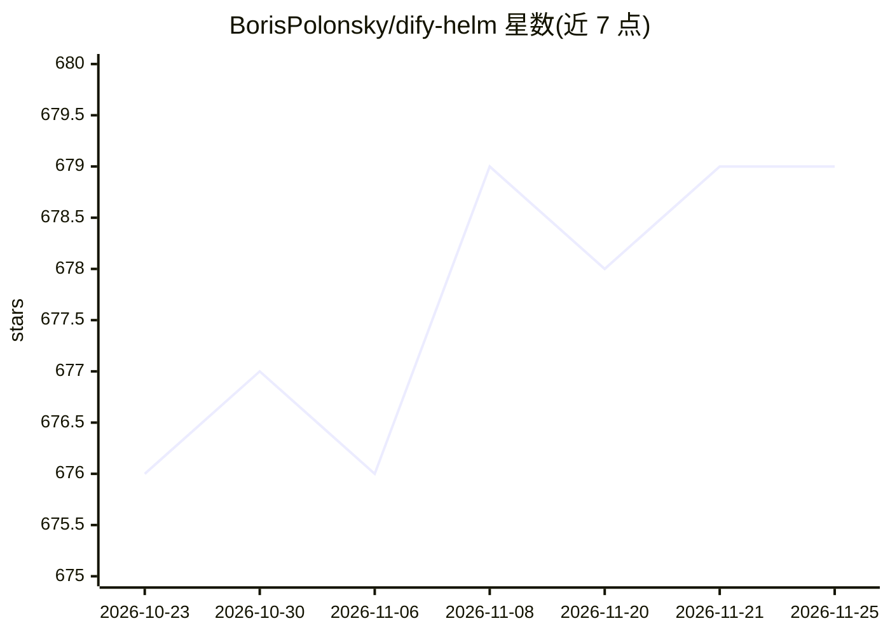

# BorisPolonsky/dify-helm

⭐ 679 · Go Template · MIT · 推送 2026-11-23 · [GitHub](https://github.com/BorisPolonsky/dify-helm) · 个人维护

**用 Helm Chart 在 Kubernetes 上部署 Dify 的 LLM 应用**

为 langgenius/dify 提供的 Helm Chart，用于在 Kubernetes 集群上部署该 LLM 聊天应用。README 给出基于 Helm repo 的安装命令，声明 Kubernetes 1.23+ 与 Helm 3.12+ 的前置条件，并用架构图与表格列出部署产生的核心组件（API、Web、Worker、Sandbox、Plugin Daemon、Nginx 等）及其镜像、端口与角色，同时列出支持接入的外部 Redis、数据库、对象存储与向量库清单。

## 筛选速览

| 维度 | 判定 | 备注 |
|---|---|---|
| AI 角色 | `ai-ecosystem` | LLM/agent 周边工具 |
| 许可风险 | `permissive` | MIT |
| 部署形态 | `library` | 以包/库形式分发 |
| 模型依赖 | — | README 未给出锁定关系 |
| 硬件要求 | — | 无带数字的原话,不猜 |
| 安装摩擦 | `low` | 无编译、无系统依赖或容器化 |
| 成熟度 | — | 结构信号不足 |

## 能力要点

- 通过 helm repo add / helm install 三条命令完成部署
- 以表格列出 11 个核心组件的镜像、端口与角色
- 支持 Redis Standalone 与 Sentinel 两种模式
- 列出 8 种对象存储与 8 种外部向量库的接入支持

## 适用场景

- 在自建 Kubernetes 集群上部署 Dify 实例
- 为 Dify 接入外部 PostgreSQL/MySQL 与对象存储
- 按需替换 Weaviate/Qdrant/Milvus 等向量数据库

## 场景标签

 · 领域:LLM 基础设施/云原生部署

## 证据(README 行号)

> L7: Deploy langgenius/dify, an LLM-based chatbot app on Kubernetes with Helm chart.
> L10: - **Kubernetes**: 1.23+

## 星数曲线

2026-10-23 676 → 2026-11-25 679（+3）

---
*卡片 v1 · prompt 1.4 · 生成 2026-11-25 · 置信度 high · 依据 README sha `1a9437ff01e7` · [字段定义](../../DATASET.md)*
