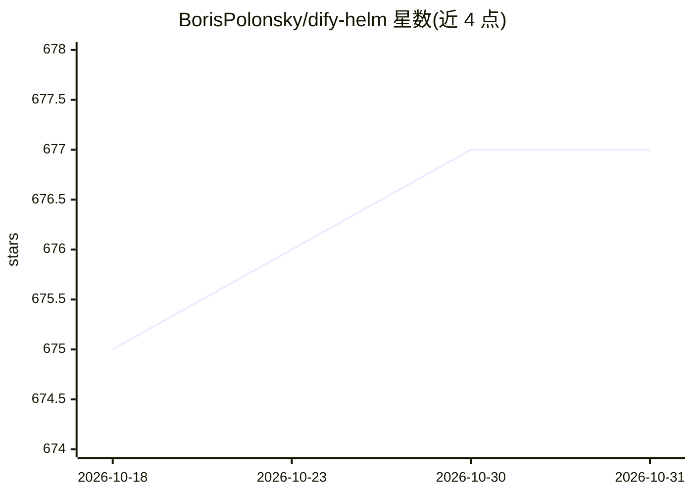

# BorisPolonsky/dify-helm

⭐ 677 · Go Template · MIT · 推送 2026-10-30 · [GitHub](https://github.com/BorisPolonsky/dify-helm) · 个人维护

**在 Kubernetes 上用 Helm 部署 Dify LLM 应用的 Chart**

提供 langgenius/dify 的 Helm Chart，将 Dify 的 API、Web、Worker、Sandbox、Agent Backend、Plugin Daemon 等十余个组件以容器化方式编排到 Kubernetes，并通过 Nginx 反向代理统一流量路由。面向需要在 K8s 环境运行 Dify 的运维/开发者，要求 Kubernetes 1.23+ 与 Helm 3.12+。支持外接 Redis（含 Sentinel）、PostgreSQL/MySQL、多种对象存储（S3/OSS/COS 等）与 9 种向量数据库（Weaviate/Qdrant/Milvus 等）。

## 筛选速览

| 维度 | 判定 | 备注 |
|---|---|---|
| AI 角色 | `ai-ecosystem` | LLM/agent 周边工具 |
| 许可风险 | `permissive` | MIT |
| 部署形态 | `library` | 以包/库形式分发 |
| 模型依赖 | — | README 未给出锁定关系 |
| 硬件要求 | — | 无带数字的原话,不猜 |
| 安装摩擦 | `low` | 无编译、无系统依赖或容器化 |
| 成熟度 | — | 结构信号不足 |

## 能力要点

- 以 Helm Chart 编排 Dify 全套组件（API/Web/Worker/Sandbox/Plugin 等）
- Nginx 反向代理统一流量路由与负载均衡
- 支持外接 Redis、PostgreSQL/MySQL、7 种对象存储、9 种向量数据库
- 要求 Kubernetes 1.23+ 与 Helm 3.12+

## 适用场景

- 在自有 Kubernetes 集群上部署 Dify
- 为 Dify 配置外接数据库与云对象存储
- 按服务拓扑了解 Dify 的网络架构与组件分工

## 场景标签

 · 领域:云原生/LLM 应用部署

## 证据(README 行号)

> L7: Deploy langgenius/dify, an LLM-based chatbot app on Kubernetes with Helm chart.
> L9: ## Prerequisites
> L10: - **Kubernetes**: 1.23+

## 星数曲线

2026-10-18 675 → 2026-10-31 677（+2）

---
*卡片 v1 · prompt 1.4 · 生成 2026-10-22 · 置信度 high · 依据 README sha `f801efd07e36` · [字段定义](../../DATASET.md)*
