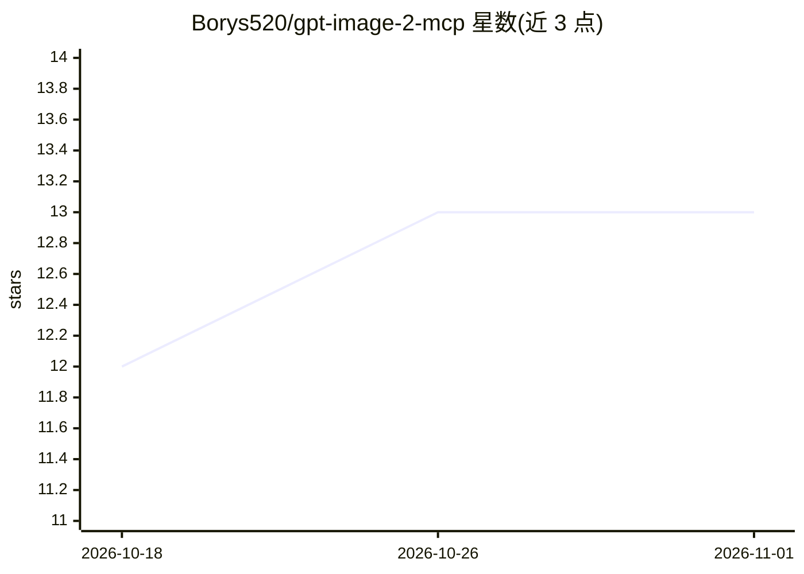

# Borys520/gpt-image-2-mcp

⭐ 13 · TypeScript · MIT · 推送 2026-09-07 · [GitHub](https://github.com/Borys520/gpt-image-2-mcp) · 个人维护

**把 OpenAI gpt-image-2 图像生成/编辑暴露给 MCP 客户端的服务器**

TypeScript 编写的 MCP server，向 Claude Desktop、Claude Code、Cursor 等 MCP 客户端提供六个工具：单次文生图、最多 8 张参考图（可带 mask）的单次编辑，以及多轮迭代编辑会话（上一轮输出自动作为下一轮输入）。每次生成保存到磁盘并以内联 ImageContent 返回给调用方模型，同时输出 token 用量与估算费用。需要 Node.js ≥ 22 和有 gpt-image-2 权限的 OpenAI API key；编辑走 /v1/images/edits，保留 Responses API 回退路由；会话仅存内存、重启即失；无硬性消费限额。

## 筛选速览

| 维度 | 判定 | 备注 |
|---|---|---|
| AI 角色 | `ai-ecosystem` | LLM/agent 周边工具 |
| 许可风险 | `permissive` | MIT |
| 部署形态 | `library` | 以包/库形式分发 |
| 模型依赖 | — | README 未给出锁定关系 |
| 硬件要求 | — | 无带数字的原话,不猜 |
| 安装摩擦 | `low` | 无编译、无系统依赖或容器化 |
| 成熟度 | — | 结构信号不足 |

## 能力要点

- 六工具：generate/edit_image 与多轮迭代编辑会话（start/continue/end/list）
- 生成图保存磁盘并以 ImageContent 内联返回，附 token 用量与费用估算
- 支持透明背景、自定义尺寸（16 倍数、≤3840px 边、1:3 宽高比）并前置校验
- 编辑调用直连 /v1/images/edits，保留 Responses API 自动回退（可强制固定）

## 适用场景

- 在 Claude Desktop/Cursor 等客户端里直接调用 gpt-image-2 生成图片
- 基于参考图做多轮迭代式图像精修
- 在 MCP Inspector 中交互测试图像生成工具

## 场景标签

`图像生成` · 领域:内容生成

## 证据(README 行号)

> L3: An MCP server that exposes OpenAI's **gpt-image-2** (released 2026-04-21) to any MCP client — Claude Desktop, Claude
> L9: |`generate_image`|text → image|
> L20: - Node.js ≥ 22 (required by `openai` v7)

## 星数曲线

2026-10-18 12 → 2026-11-01 13（+1）

---
*卡片 v1 · prompt 1.4 · 生成 2026-10-31 · 置信度 mid · 依据 README sha `387f897b7a2d` · [字段定义](../../DATASET.md)*
