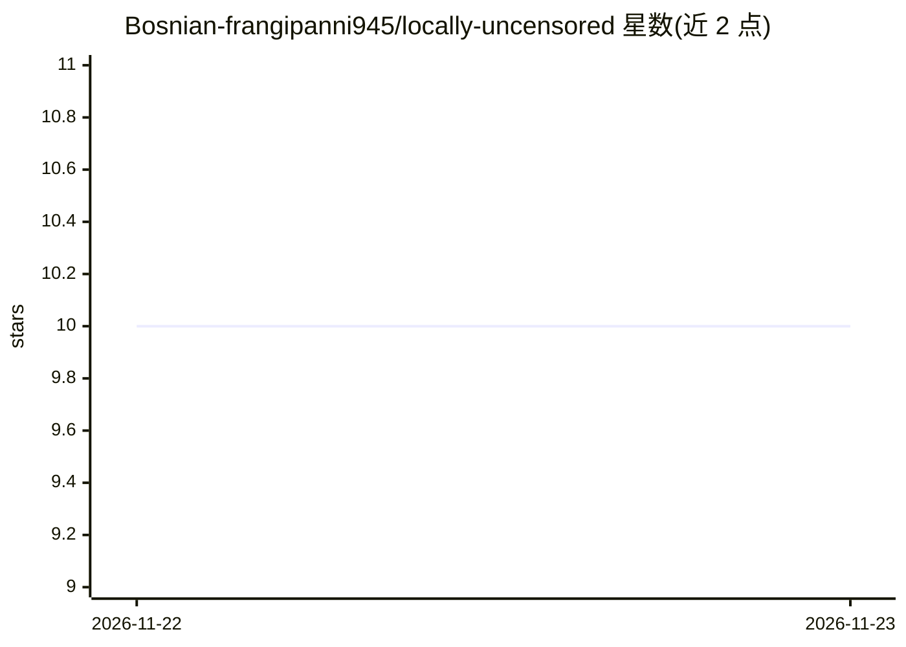

# Bosnian-frangipanni945/locally-uncensored

⭐ 10 · 推送 2026-10-13 · [GitHub](https://github.com/Bosnian-frangipanni945/locally-uncensored) · 个人维护

**本地运行文本/图像/视频 AI，无需云端与 API key**

README 可见内容仅一行标题，无法验证具体功能细节。仓库描述声明：在本地运行文本、图像与视频 AI，不使用云端、不收集数据、无需 API key，并可自动检测 12 种本地后端。主题标签涉及 ComfyUI、本地 LLM、Mistral 等方向。安装方式、运行要求与维护者信息在 README 中均不可验证。

## 筛选速览

| 维度 | 判定 | 备注 |
|---|---|---|
| AI 角色 | `ai-ecosystem` | LLM/agent 周边工具 |
| 许可风险 | `none` | — |
| 部署形态 | `None` |  |
| 模型依赖 | — | README 未给出锁定关系 |
| 硬件要求 | — | 无带数字的原话,不猜 |
| 安装摩擦 | `low` | 无编译、无系统依赖或容器化 |
| 成熟度 | — | 结构信号不足 |

## 能力要点

- 声明支持文本、图像与视频三类本地 AI 运行
- 声明自动检测 12 种本地后端
- 声明无云端、无数据收集、无 API key

## 适用场景

- 在无网络或离线环境下运行本地生成模型
- 避免数据上传云端的本地推理需求

## 场景标签

 · 领域:本地 AI 运行工具

## 证据(README 行号)

> L1: # locally-uncensored

## 星数曲线

2026-11-22 10 → 2026-11-23 10（+0）

---
*卡片 v1 · prompt 1.4 · 生成 2026-11-22 · 置信度 low · 依据 README sha `0196cf173993` · [字段定义](../../DATASET.md)*
