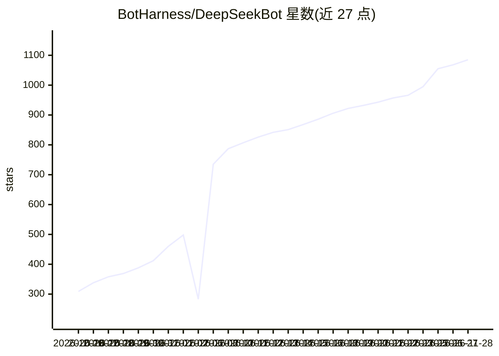

# BotHarness/DeepSeekBot

⭐ 1,085 · TypeScript · MIT · 推送 2026-11-27 · [GitHub](https://github.com/BotHarness/DeepSeekBot) · [官网](https://tobs.app) · 组织维护 · 中文 README

**基于 DeepSeek Harness 的开源多 Bot 个人 AI 团队插件**

Tobs（原名 DeepSeekBot）是运行在 DeepSeek Harness（DSH）上的 MIT 开源插件，用于创建多个有身份、人格和长期记忆的个人 AI Bot。关键机制：每个 Bot 的记忆是普通 Git 仓库，可审阅、修改并推送到 GitHub 跨机同步；支持群聊协作、任务委派、定时任务、浏览器与桌面操作、Bot 市场。需在 DSH 桌面端安装，运行 DSH 的电脑要保持在线，模型使用 DSH 配置的服务商和额度。与名称相近的 DS Bot（npm ds-bot）是两个独立项目。

## 筛选速览

| 维度 | 判定 | 备注 |
|---|---|---|
| AI 角色 | `ai-ecosystem` | LLM/agent 周边工具 |
| 许可风险 | `permissive` | MIT |
| 部署形态 | `library` | 以包/库形式分发 |
| 模型依赖 | — | README 未给出锁定关系 |
| 硬件要求 | — | 无带数字的原话,不猜 |
| 安装摩擦 | `low` | 无编译、无系统依赖或容器化 |
| 成熟度 | — | 结构信号不足 |

## 能力要点

- 每个 Bot 记忆为 Git 仓库，可审阅、修改并跨机同步
- 接入 Slack、Discord、飞书/Lark、QQ、微信以 Bot 身份收发消息
- Bot 市场：安装/分享 Bot，支持 zip 导入导出
- 定时任务与授权后的浏览器/桌面自动化操作

## 适用场景

- 创建研究员、设计师等分工 Bot 组成个人 AI 团队
- 在 Slack/Discord/微信等 IM 里以 Bot 身份回复消息
- 让 Bot 记住项目背景，跨设备继续协作

## 场景标签

`Agent 记忆` `多智能体` `GUI 自动化` `浏览器自动化` · 领域:Agent 开发

## 证据(README 行号)

> L27: Tobs（托布）是 BotHarness 开发的 MIT 开源 GrokBot 平替，作为插件运行在 DeepSeek Harness（DSH）里。你可以创建几个分别负责研究、写作或写代码的 Bot，像和同事一样私聊、拉群、派活；
> L73: 每个 Bot 的记忆就是一个普通的 Git 仓库。你可以在侧栏翻看它记了什么、哪天改了哪几行，觉得不对就直接改；推到 GitHub，就能在几台电脑之间共用同一个 Bot。详见记忆演化指南。
> L123: 不是。它使用 DSH 中配置的模型提供商；能否接入取决于接口支持、模型配置与凭据。Bot 的记忆和聊天记录保存在自己的宿主，调用远程模型时相关上下文仍会发给所选服务商。

## 星数曲线

2026-10-26 309 → 2026-11-28 1,085（+776）

---
*卡片 v1 · prompt 1.4 · 生成 2026-11-26 · 置信度 high · 依据 README sha `8164f2d602ff` · [字段定义](../../DATASET.md)*
