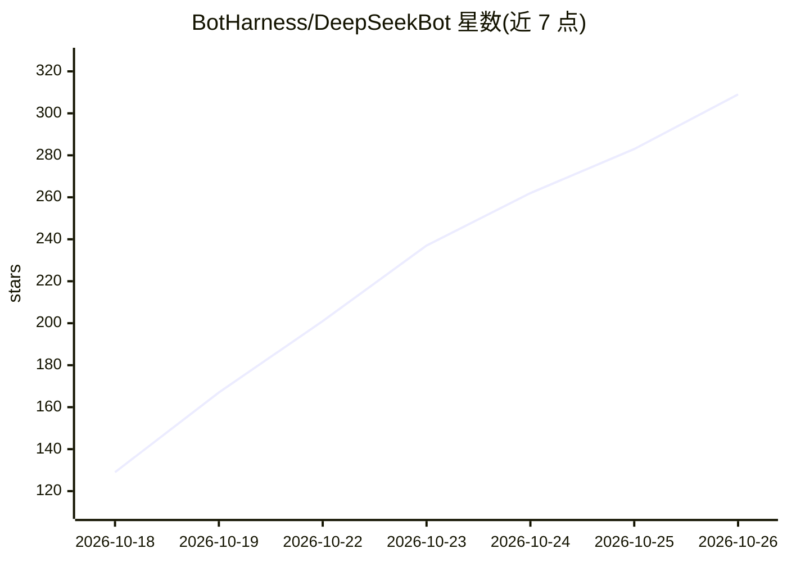

# BotHarness/DeepSeekBot

⭐ 309 · TypeScript · MIT · 推送 2026-10-25 · [GitHub](https://github.com/BotHarness/DeepSeekBot) · [官网](https://deepseekbot.app) · 组织维护 · 中文 README

**运行在 DeepSeek Harness 上的个人 AI Bot 团队插件（GrokBot 平替）**

DeepSeekBot（DSB）是 BotHarness 维护的 MIT 开源插件，作为 GrokBot 的替代方案运行在 DeepSeek Harness（DSH）桌面端。用户可创建多名有身份、人格与像素头像的 Bot，私聊、拉群、委派任务；每个 Bot 的记忆是一个可审阅的 Git 仓库，可推送到 GitHub 在多机共享。支持接入 Slack、Discord、飞书/Lark、QQ、微信，提供定时任务、电脑/浏览器操作、Bot 市场与导入导出。模型由 DSH 中配置的服务商提供，后台工作需宿主电脑保持在线。安装方式为在 DSH 插件页添加 `deepseekbot@1.4.1`。

## 筛选速览

| 维度 | 判定 | 备注 |
|---|---|---|
| AI 角色 | `ai-native` | 本体是模型或模型工具 |
| 许可风险 | `permissive` | MIT |
| 部署形态 | `library` | 以包/库形式分发 |
| 模型依赖 | — | README 未给出锁定关系 |
| 硬件要求 | — | 无带数字的原话,不猜 |
| 安装摩擦 | `low` | 无编译、无系统依赖或容器化 |
| 成熟度 | — | 结构信号不足 |

## 能力要点

- 每个 Bot 拥有独立 Git 仓库形式的记忆，可审阅、修改并推送到 GitHub 多机同步
- 多 Bot 群聊协作、任务委派与定时任务
- 以 Bot 自己身份接入 Slack/Discord/飞书/微信/QQ 等 IM
- Bot 市场可浏览、安装他人分享的 Bot

## 适用场景

- 搭建自己的研究员、设计师、工程师 AI Bot 小团队并长期协作
- 在常用聊天软件里让 Bot 以固定身份回复消息
- 给 Bot 设置定时任务（如每天早上发送日志摘要）
- 通过 Git 审阅和纠正 Bot 记住的偏好与项目背景

## 场景标签

`Agent 记忆` `多智能体` `聊天机器人` · 领域:Agent 开发

## 证据(README 行号)

> L25: DeepSeekBot（简称 **DSB**，是 DeepSeekBot 的缩写，才不是“大啥比”，哼）是 BotHarness 开发的 MIT 开源 GrokBot 平替，作为插件运行在 DeepSeek Harness（DSH
> L39: |**一支自己的 AI 小团队**|创建研究员、设计师、工程师等 Bot，每个都有名字、人格和像素头像，换个对话也还是同一个它。|

## 星数曲线

2026-10-18 129 → 2026-10-26 309（+180）

---
*卡片 v1 · prompt 1.4 · 生成 2026-10-22 · 置信度 mid · 依据 README sha `98718e6946ce` · [字段定义](../../DATASET.md)*
