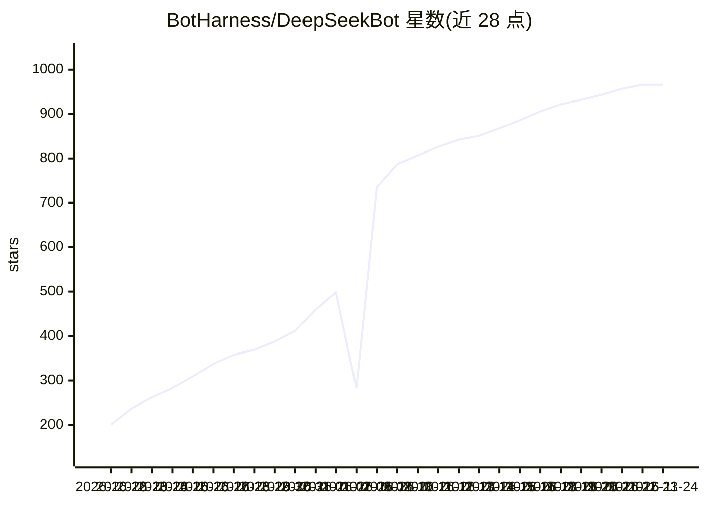

# BotHarness/DeepSeekBot

⭐ 995 · TypeScript · MIT · 推送 2026-11-24 · [GitHub](https://github.com/BotHarness/DeepSeekBot) · [官网](https://tobs.app) · 组织维护 · 中文 README

**给个人用户的开源多 Bot 团队：长期记忆、IM 接入、插件扩展**

Tobs（原名 DeepSeekBot）是 BotHarness 开发的 MIT 开源项目，作为插件运行在 DeepSeek Harness（DSH）中。用户可创建多个有名字、人格与像素头像的 Bot，各自拥有以 Git 仓库存储的可审阅记忆，支持群聊 @ 协作、任务委派、定时任务、Bot 市场安装分享。Bot 可接入 Slack、Discord、飞书/Lark、QQ、微信以自身身份收发消息，授权后可操作浏览器与共享桌面。模型使用用户在 DSH 中配置的服务商与额度；Bot 持续工作需宿主机保持在线。

## 筛选速览

| 维度 | 判定 | 备注 |
|---|---|---|
| AI 角色 | `ai-native` | 本体是模型或模型工具 |
| 许可风险 | `permissive` | MIT |
| 部署形态 | `library` | 以包/库形式分发 |
| 模型依赖 | — | README 未给出锁定关系 |
| 硬件要求 | — | 无带数字的原话,不猜 |
| 安装摩擦 | `low` | 无编译、无系统依赖或容器化 |
| 成熟度 | — | 结构信号不足 |

## 能力要点

- 每个 Bot 的记忆是普通 Git 仓库，可翻看、修改、推 GitHub 多机同步
- 接入 Slack、Discord、飞书、QQ、微信，Bot 以自己身份回复
- 定时任务、群聊 @ 协作、任务委派与 Bot 市场安装分享
- 授权后可操作浏览器与共享桌面

## 适用场景

- 创建研究、写作、写代码等分工不同的 Bot 像同事一样协作
- 让 Bot 在微信/飞书/Discord 群里以固定身份回复消息
- 用一句话让 Bot 建立每天定时汇报的自动化任务
- 在不同电脑间同步使用同一套 Bot 及其记忆

## 场景标签

`Agent 记忆` `多智能体` `聊天机器人` · 领域:Agent 开发

## 证据(README 行号)

> L27: Tobs（托布）是 BotHarness 开发的 MIT 开源 GrokBot 平替，作为插件运行在 DeepSeek Harness（DSH）里。你可以创建几个分别负责研究、写作或写代码的 Bot，像和同事一样私聊、拉群、派活；
> L44: |**让 Bot 记住你**|Bot 会记下你的偏好和项目背景，下次直接接着干；记忆随时能翻看、纠正，也能同步到别的电脑。|
> L123: 不是。它使用 DSH 中配置的模型提供商；能否接入取决于接口支持、模型配置与凭据。Bot 的记忆和聊天记录保存在自己的宿主，调用远程模型时相关上下文仍会发给所选服务商。

## 星数曲线

2026-10-22 201 → 2026-11-24 966（+765）

---
*卡片 v1 · prompt 1.4 · 生成 2026-11-24 · 置信度 high · 依据 README sha `f03516a4514a` · [字段定义](../../DATASET.md)*
