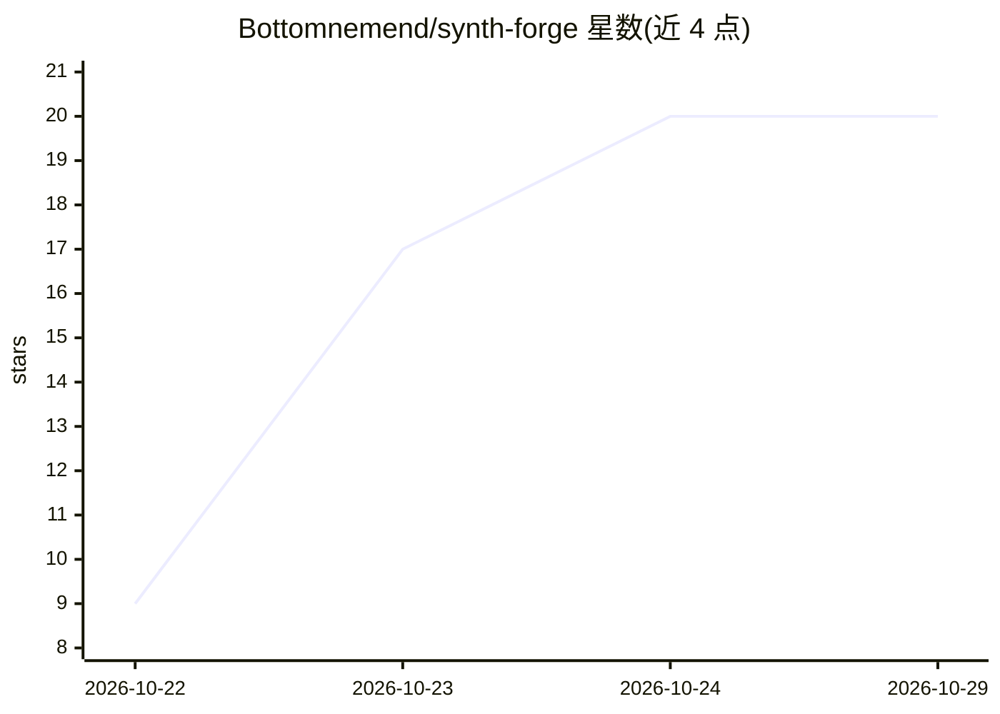

# Bottomnemend/synth-forge

⭐ 20 · C# · MIT · 推送 2026-10-18 · [GitHub](https://github.com/Bottomnemend/synth-forge) · 个人维护

**Windows 本地批量文生图工作室：CSV 批量、img2img、便携 exe**

面向 Windows 10/11 x64 用户的本地图像生成桌面工具：提供批量提示词 CSV 队列（含种子）、可编辑风格预设、图生图（强度与降噪控制）、种子锁定、显存安全预设与带元数据 sidecar 的画廊。以约 100 MB 免安装自包含 exe 分发（运行时打包，模型单独下载），之后离线使用，MIT 许可。也可用 .NET 8 SDK 自行构建。README 提供安装包下载链接（压缩包带密码）与 SHA-256 校验。

## 筛选速览

| 维度 | 判定 | 备注 |
|---|---|---|
| AI 角色 | `ai-native` | 本体是模型或模型工具 |
| 许可风险 | `permissive` | MIT |
| 部署形态 | `None` |  |
| 模型依赖 | — | README 未给出锁定关系 |
| 硬件要求 | — | 无带数字的原话,不猜 |
| 安装摩擦 | `medium` | 含编译或系统依赖之一 |
| 成熟度 | — | 结构信号不足 |

## 能力要点

- CSV 批量提示词+种子，隔夜生成并组织为画廊
- 风格预设、img2img 强度/降噪控制、种子锁定
- 约 100 MB 自包含便携 exe，模型单独下载，此后离线
- 画廊为每张输出保存提示词、种子与设置 sidecar

## 适用场景

- 不想搭 Python 环境在 Windows 本地跑文生图
- 用 CSV 批量跑大量提示词组合
- 用图生图与种子锁定迭代细节

## 场景标签

`图像生成` · 领域:内容生成

## 证据(README 行号)

> L3: ⚗️ Free, open-source local image generation studio for Windows — batch prompts, seeds, img2img. 100 MB portable, off
> L11: - ✅ **Batch prompt runs** — a CSV of prompts and seeds generates overnight into an organized gallery
> L13: - ✅ **Image-to-image** — strength dial and denoise control take an existing image in a new direction

## 星数曲线

2026-10-22 9 → 2026-10-29 20（+11）

---
*卡片 v1 · prompt 1.4 · 生成 2026-10-28 · 置信度 high · 依据 README sha `9164812b4a54` · [字段定义](../../DATASET.md)*
