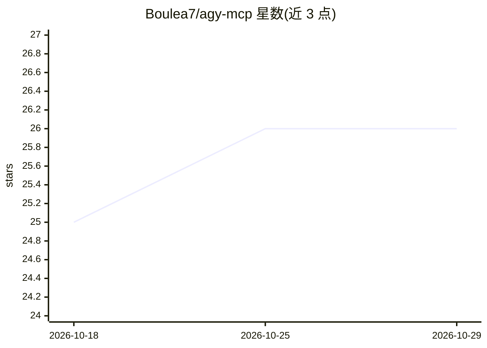

# Boulea7/agy-mcp

⭐ 26 · Python · MIT · 推送 2026-10-14 · [GitHub](https://github.com/Boulea7/agy-mcp) · [官网](https://pypi.org/project/agy-mcp/) · 个人维护 · 中文 README

**把 Google Antigravity CLI 包装成 MCP 工具供任意 MCP 客户端调用**

Python 编写的 MCP server，将 Google Antigravity CLI（agy）包装为 11 个 typed MCP 工具（同步调用、后台长任务、状态轮询、会话管理等），经 FastMCP stdio 暴露，任何 MCP 客户端可接入；另提供可选 Skill bundle 装入 Claude Code / OpenAI Codex / Antigravity 的技能目录，教 agent 何时调用。两条路径共享 bridge/adapter/safety policy/worktree 后端。安全机制含敏感信息脱敏、写操作显式授权、worktree 隔离。仅包装不重新实现 agy API，调用会消耗 Antigravity 请求额度。

## 筛选速览

| 维度 | 判定 | 备注 |
|---|---|---|
| AI 角色 | `ai-ecosystem` | LLM/agent 周边工具 |
| 许可风险 | `permissive` | MIT |
| 部署形态 | `library` | 以包/库形式分发 |
| 模型依赖 | — | README 未给出锁定关系 |
| 硬件要求 | — | 无带数字的原话,不猜 |
| 安装摩擦 | `low` | 无编译、无系统依赖或容器化 |
| 成熟度 | — | 结构信号不足 |

## 能力要点

- 11 个 typed MCP 工具：同步调用、后台长任务（job 生命周期管理）、会话管理、环境探测
- Skill bundle 安装到 Claude Code / OpenAI Codex / Antigravity 技能目录
- SafetyPolicy 脱敏（路径/PEM/JWT/Bearer）与 execute 模式 worktree 隔离
- hybrid backend：stdout + klog + transcript.jsonl + 协议翻译器

## 适用场景

- 在 Claude Code / Codex / Cursor 中把 Antigravity 作为第二 agent 协作（如 code review 第二意见）
- 以 mode=long 后台运行数小时级大重构任务并轮询结果
- 在 worktree 隔离下让 agent 应用已审查的 diff

## 场景标签

`编码 Agent` `Agent 框架` · 领域:Agent 开发

## 证据(README 行号)

> L59: 把 Google 新发布的 Antigravity CLI（`agy`）包装成可被任意 MCP 客户端
> L62: - **MCP server**：`agymcp` 经 FastMCP stdio 暴露 11 个 typed JSON 工具，

## 星数曲线

2026-10-18 25 → 2026-10-29 26（+1）

---
*卡片 v1 · prompt 1.4 · 生成 2026-10-26 · 置信度 mid · 依据 README sha `b2795ec13f77` · [字段定义](../../DATASET.md)*
