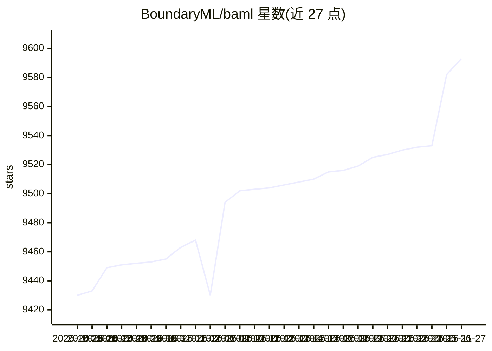

# BoundaryML/baml

⭐ 9,593 · Rust · Apache-2.0 · 推送 2026-11-26 · [GitHub](https://github.com/BoundaryML/baml) · [官网](https://boundaryml.com/explore) · 组织维护

**面向 agent 开发的领域编程语言**

BAML 是一门面向 agent 开发的编程语言，语法类似 TypeScript，提供类型系统、运行时类型保持、类型化错误与静态分析、文件系统组织的模块结构、并发机制，并内置测试/eval 框架与 agent 标准库。BAML 函数可从 TypeScript、Python、Go、C#、Java 等语言调用，支持独立运行或增量引入。安装方式包括 Homebrew，另提供 IDE 插件安装命令。

## 筛选速览

| 维度 | 判定 | 备注 |
|---|---|---|
| AI 角色 | `ai-ecosystem` | LLM/agent 周边工具 |
| 许可风险 | `permissive` | Apache-2.0 |
| 部署形态 | `None` |  |
| 模型依赖 | — | README 未给出锁定关系 |
| 硬件要求 | — | 无带数字的原话,不猜 |
| 安装摩擦 | `low` | 无编译、无系统依赖或容器化 |
| 成熟度 | — | 结构信号不足 |

## 能力要点

- 带类型系统与静态分析的 agent 编程语言
- 内置测试/eval 框架与 agent 标准库
- 支持从 TS、Py、Go、C#、Java 等语言调用 BAML 函数
- 提供 IDE 插件安装命令

## 适用场景

- 为 agent 项目引入类型化提示函数
- 在既有 TS/Python/Go 等代码库中增量接入 BAML
- 对 agent 输出运行内置测试与评估

## 场景标签

`Agent 框架` `提示工程` `模型评测` · 领域:Agent 开发

## 证据(README 行号)

> L9: BAML is the programming language for agents.
> L22: - Built-in tests / eval framework
> L25: - Can be run standalone or adopt incrementally (you can call a BAML function from TS, Py, Go, C#, Java, etc).

## 星数曲线

2026-10-25 9,430 → 2026-11-27 9,593（+163）

---
*卡片 v1 · prompt 1.4 · 生成 2026-11-22 · 置信度 mid · 依据 README sha `4fa3899a8480` · [字段定义](../../DATASET.md)*
