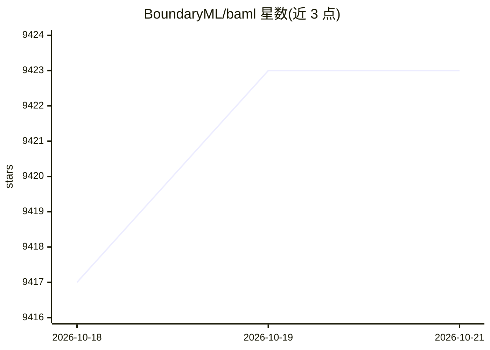

# BoundaryML/baml

⭐ — · [GitHub]() · 组织维护

**面向 agent 的编程语言，类型系统约束 LLM 输出**

BoundaryML 开发的领域语言，语法类似 TypeScript，用于编写 agent 相关逻辑：类型在运行时持久化、无 any 类型、错误可静态分析、内置测试/评测框架与 agent 标准库，编译到 TS、Python、Go、C#、Java 等语言的调用接口，支持独立运行或渐进式嵌入现有工程。提供 brew 安装与 CLI（init、agent install、IDE 插件安装）。README 未列出具体 LLM 提供商接入细节。

## 筛选速览

| 维度 | 判定 | 备注 |
|---|---|---|
| AI 角色 | `ai-ecosystem` | LLM/agent 周边工具 |
| 许可风险 | `permissive` | — |
| 部署形态 | `None` |  |
| 模型依赖 | — | README 未给出锁定关系 |
| 硬件要求 | — | 无带数字的原话,不猜 |
| 安装摩擦 | `low` | 无编译、无系统依赖或容器化 |
| 成熟度 | — | 结构信号不足 |

## 能力要点

- 类型系统在运行时持久化，无 any 与危险类型转换
- 错误类型化并可静态分析
- 内置测试/评测框架与 agent 标准库
- 可从 TS/Python/Go/C#/Java 调用，支持渐进式采用

## 适用场景

- 为 LLM 调用定义强类型接口，减少 agent 输出错误
- 在现有 TS/Python 工程中渐进式引入 BAML 函数
- 用内置评测框架测试 agent 行为

## 场景标签

`模型评测` `提示工程` · 领域:Agent 开发

## 证据(README 行号)

> L9: BAML is the programming language for agents.
> L25: - Can be run standalone or adopt incrementally (you can call a BAML function from TS, Py, Go, C#, Java, etc).

## 星数曲线

2026-10-18 9,417 → 2026-10-21 9,423（+6）

---
*卡片 v1 · prompt 1.4 · 生成 2026-10-20 · 置信度 high · 依据 README sha `2e1ec6260669` · [字段定义](../../DATASET.md)*
