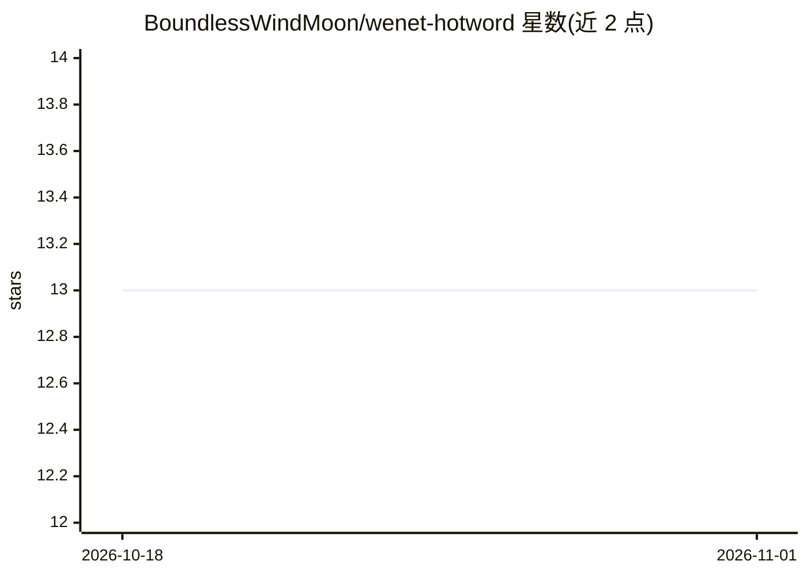

# BoundlessWindMoon/wenet-hotword

⭐ 13 · Python · Apache-2.0 · 推送 2026-05-21 · [GitHub](https://github.com/BoundlessWindMoon/wenet-hotword) · 个人维护 · 中文 README

**WeNet C++ 运行时的热词偏置解码扩展，提升 ASR 热词召回**

面向 WeNet C++ 运行时的热词偏置解码方案：基于 u2pp_conformer 中文流式模型，在 n-best 结果上通过 G2P 音素编辑距离做模糊热词匹配（PhonemeCorrector），叠加按声学置信度加权的匹配奖励，并提供对解码器与热词参数做 2D/3D Pareto 多目标自动调参的工具。内置 Aggressive/Balanced/Conservative/Ultra 四种模式配置，在 AISHELL-1/2 热词测试集上给出 CER、召回、精确率结果。需 Python 环境与 C++17 运行时，经 ModelScope 下载模型与脚本准备数据集。

## 筛选速览

| 维度 | 判定 | 备注 |
|---|---|---|
| AI 角色 | `ai-native` | 本体是模型或模型工具 |
| 许可风险 | `permissive` | Apache-2.0 |
| 部署形态 | `None` |  |
| 模型依赖 | — | README 未给出锁定关系 |
| 硬件要求 | — | 无带数字的原话,不猜 |
| 安装摩擦 | `low` | 无编译、无系统依赖或容器化 |
| 成熟度 | — | 结构信号不足 |

## 能力要点

- n-best 上的 G2P 音素编辑距离模糊热词匹配
- 按声学置信度加权的逐热词奖励
- 2D/3D Pareto 多目标自动调参（含早停停滞检测）
- 四种预置模式（Aggressive/Balanced/Conservative/Ultra）配置

## 适用场景

- 中文语音助手中提升专有名词与热词的识别召回
- 金融/法律等低误报容忍场景选择 Ultra 模式热词偏置
- 为自己的 WeNet 模型学习混淆矩阵并自动调参

## 场景标签

`语音识别` · 领域:感知与多模态

## 证据(README 行号)

> L6: **Hotword-biased decoding for the WeNet C++ runtime.**
> L32: * **Phoneme Corrector** — fuzzy hotword matching via G2P phoneme edit-distance on the n-best

## 星数曲线

2026-10-18 13 → 2026-11-01 13（+0）

---
*卡片 v1 · prompt 1.4 · 生成 2026-10-31 · 置信度 high · 依据 README sha `28011a99e758` · [字段定义](../../DATASET.md)*
