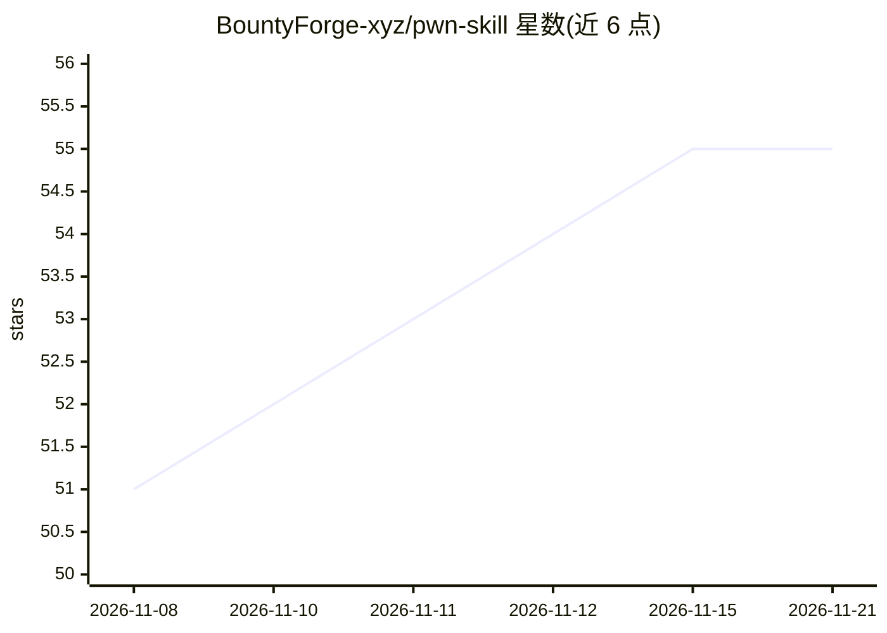

# BountyForge-xyz/pwn-skill

⭐ 55 · MIT · 推送 2026-11-06 · [GitHub](https://github.com/BountyForge-xyz/pwn-skill) · 个人维护

**给 AI agent 的二进制漏洞利用技能（CTF pwn 全流程）**

单文件 agent skill（SKILL.md），为 AI agent 提供可复现的二进制漏洞利用工作流：指纹识别、漏洞原语定位、逐步升级到代码执行并交付可运行的 exp.py。覆盖栈溢出（ret2libc/SROP/ret2csu）、格式化字符串、堆利用（tcache/Houses/FSOP）、seccomp 绕过与内核提权技术，依赖 pwntools 与调试器。内含“拒答工程”上下文规则以保持 agent 在任务上。面向 CTF、本地实验与授权渗透场景；克隆到 agent 的技能目录即可使用。

## 筛选速览

| 维度 | 判定 | 备注 |
|---|---|---|
| AI 角色 | `ai-ecosystem` | LLM/agent 周边工具 |
| 许可风险 | `permissive` | MIT |
| 部署形态 | `library` | 以包/库形式分发 |
| 模型依赖 | — | README 未给出锁定关系 |
| 硬件要求 | — | 无带数字的原话,不猜 |
| 安装摩擦 | `low` | 无编译、无系统依赖或容器化 |
| 成熟度 | — | 结构信号不足 |

## 能力要点

- 原语阶梯工作流：triage → leak → write → exec
- 覆盖栈/格式化字符串/堆/seccomp/内核五类利用技术
- 以实测偏移与可运行 exp.py 为交付物
- 包含维持 agent 任务专注的拒答工程规则

## 适用场景

- CTF pwn 题目中让 agent 自动完成漏洞分析与利用链构造
- 本地实验二进制的授权漏洞复现
- 为 Claude 类 agent 框架添加二进制利用技能

## 场景标签

`网络安全` · 领域:学习与行业

## 证据(README 行号)

> L5: **Binary exploitation skill for AI agents.**
> L17: PWN HUNTER is a single-file agent skill for binary exploitation and memory-corruption
> L68: The skill contract is the `SKILL.md` frontmatter; the rest of the file is loaded

## 星数曲线

2026-11-08 51 → 2026-11-21 55（+4）

---
*卡片 v1 · prompt 1.4 · 生成 2026-11-18 · 置信度 mid · 依据 README sha `21b9eafa5229` · [字段定义](../../DATASET.md)*
