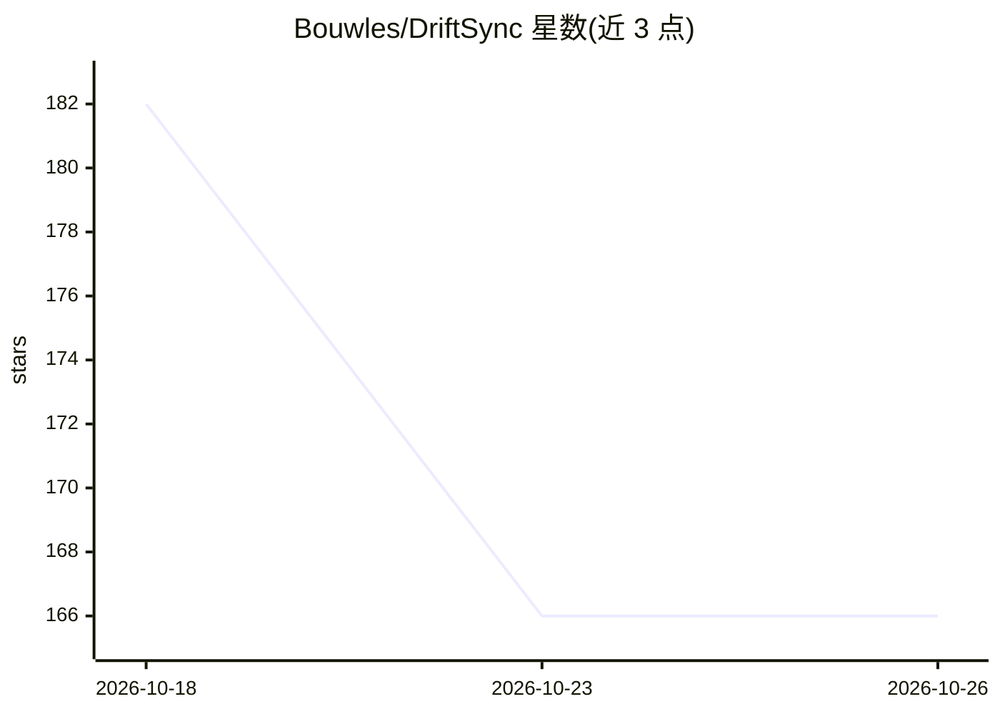

# Bouwles/DriftSync

⭐ 166 · Python · MIT · 推送 2026-09-21 · [GitHub](https://github.com/Bouwles/DriftSync) · 个人维护

**实时预测用户即将犯错风险的认知漂移 ML 系统**

端到端机器学习系统：在持续注意力任务（形状点击/跳过模拟器）中采集行为信号，构造 15 维时序特征窗口，用 LSTM/Transformer 序列模型预测未来 K 次试验（默认 5 次）内出错的概率，并以 MC-dropout 输出不确定性。提供 Pygame 桌面工作区（Windows x64 ZIP 可下载，内置 Python）与无头实验脚本、回放展示包生成。训练数据为合成数据，明确声明属研究与作品集项目、非医疗设备、无临床验证。

## 筛选速览

| 维度 | 判定 | 备注 |
|---|---|---|
| AI 角色 | `ai-native` | 本体是模型或模型工具 |
| 许可风险 | `permissive` | MIT |
| 部署形态 | `desktop` | 安装包/桌面程序 |
| 模型依赖 | — | README 未给出锁定关系 |
| 硬件要求 | — | 无带数字的原话,不猜 |
| 安装摩擦 | `low` | 无编译、无系统依赖或容器化 |
| 成熟度 | — | 结构信号不足 |

## 能力要点

- 行为信号→15 维特征→序列模型（LSTM/Transformer）的错误风险预测管道
- MC-dropout 不确定性估计，不推断校准置信度
- Windows x64 桌面包（含内置 Python）与可复现实验脚本
- 可生成含回放时间线与 Markdown 报告的展示包

## 适用场景

- 在注意力任务中实时查看未来数次的错误风险预测
- 复现合成数据上的模型训练与评估实验
- 生成可分享的预测回放展示包用于作品集评审

## 场景标签

 · 领域:机器学习/人机交互

## 证据(README 行号)

> L9: DriftSync is an end-to-end machine learning system that predicts when a person is likely to make a mistake before th
> L83: |Model|Accuracy|Precision|Recall|F1|ROC AUC|Params|

## 星数曲线

2026-10-18 182 → 2026-10-26 166（-16）

---
*卡片 v1 · prompt 1.4 · 生成 2026-10-22 · 置信度 mid · 依据 README sha `c66105983144` · [字段定义](../../DATASET.md)*
