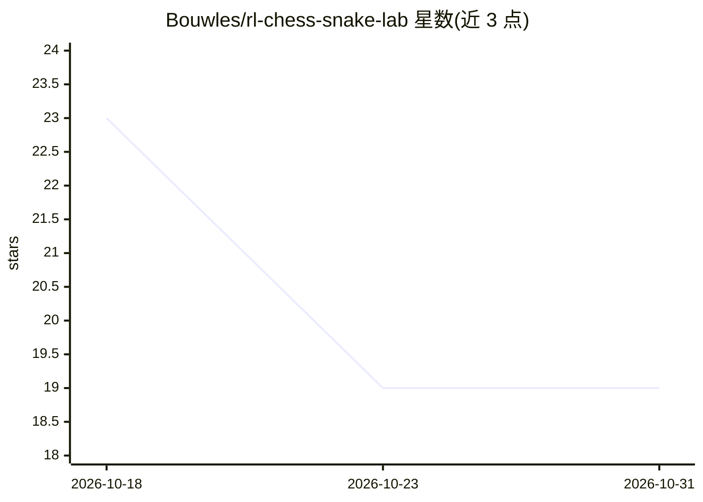

# Bouwles/rl-chess-snake-lab

⭐ 19 · Python · MIT · 推送 2026-09-09 · [GitHub](https://github.com/Bouwles/rl-chess-snake-lab) · 个人维护

**蛇与棋的强化学习实验库：DQN 与自博弈训练代码**

一个小型强化学习实验库，包含两个游戏 agent：Snake 为主实验，提供自定义 Gym 风格环境、Gymnasium 兼容包装、PyTorch DQN 模型、经验回放与 epsilon-greedy 探索；Chess 为自博弈实验，基于 python-chess 的合法走子与棋盘特征编码。仓库附带单元测试、JSON 示例配置、GIF 演示与训练日志样例。README 明确声明棋类部分不追求强棋力，默认训练规模保持较小以易于运行。

## 筛选速览

| 维度 | 判定 | 备注 |
|---|---|---|
| AI 角色 | `ai-native` | 本体是模型或模型工具 |
| 许可风险 | `permissive` | MIT |
| 部署形态 | `library` | 以包/库形式分发 |
| 模型依赖 | — | README 未给出锁定关系 |
| 硬件要求 | — | 无带数字的原话,不猜 |
| 安装摩擦 | `low` | 无编译、无系统依赖或容器化 |
| 成熟度 | — | 结构信号不足 |

## 能力要点

- 自定义 Gym 风格 Snake 环境与 Gymnasium 兼容包装
- PyTorch DQN：经验回放、epsilon-greedy、检查点与配置
- 基于 python-chess 合法走子的自博弈棋类环境与特征编码
- 游戏规则与 RL 组件的单元测试覆盖

## 适用场景

- 学习 DQN 强化学习核心机制的可读可测试代码
- 作为自博弈强化学习实验的起点进行扩展
- 通过 GIF 与示例配置快速检查环境与训练流程

## 场景标签

`强化学习` `教程课程` · 领域:学习与行业

## 证据(README 行号)

> L9: This repo is a small reinforcement learning lab with two game agents: Snake and Chess. The goal is to show the core 
> L44: - a PyTorch DQN model for Snake

## 星数曲线

2026-10-18 23 → 2026-10-31 19（-4）

---
*卡片 v1 · prompt 1.4 · 生成 2026-10-29 · 置信度 high · 依据 README sha `80e42e32ad22` · [字段定义](../../DATASET.md)*
