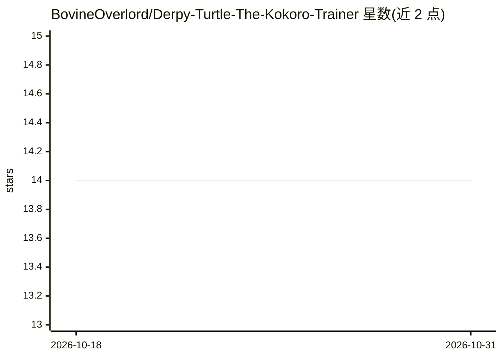

# BovineOverlord/Derpy-Turtle-The-Kokoro-Trainer

⭐ 14 · Python · NOASSERTION · 推送 2026-08-22 · [GitHub](https://github.com/BovineOverlord/Derpy-Turtle-The-Kokoro-Trainer) · 个人维护

**Windows GUI：搜索 Kokoro 语音并训练 RVC 模型逼近目标音色**

面向 Windows 的本地语音构建工具：以队列式 GUI 串联 Kokoro 语音张量随机游走/混合搜索、基于 resemblyzer 的目标音频相似度评分、目标 RVC 模型训练（Applio 后端）与生成后自动声音转换，输出最终 _rvc.wav。附带 faster-whisper 转写、语音测试与导出功能。单一启动器可执行文件自建 Python 环境。需要 Windows 10/11 与 Python 3.10-3.12；CUDA 模式实测约 4GB 显存、RTX 3060 约 4 小时，CPU 模式可用但显著更慢。

## 筛选速览

| 维度 | 判定 | 备注 |
|---|---|---|
| AI 角色 | `ai-native` | 本体是模型或模型工具 |
| 许可风险 | `none` | NOASSERTION |
| 部署形态 | `desktop` | 安装包/桌面程序 |
| 模型依赖 | — | README 未给出锁定关系 |
| 硬件要求 | `gpu-8g` | |
| 安装摩擦 | `medium` | 含编译或系统依赖之一 |
| 成熟度 | — | 结构信号不足 |

## 能力要点

- Kokoro 语音张量随机游走搜索 + 目标音频相似度评分
- 从参考音频训练目标 RVC 模型并在生成后自动转换音色
- 队列式 GUI：预设、ETA、进度日志、文本映射、WAV 播放
- 单个启动器可执行文件自建 Python 环境

## 适用场景

- 我想让本地 Kokoro TTS 的声音接近某个目标说话人
- 用自己录制的干净语音训练专属 RVC 音色模型
- 批量转写音频片段并测试候选语音效果

## 场景标签

`语音合成` `语音识别` · 领域:内容生成

## 证据(README 行号)

> L3: Derpy Turtle is a Windows-first GUI for building better local Kokoro voice outputs. It combines Kokoro voice search,
> L22: - Runs Kokoro random-walk and hybrid voice searches against one or more target clips.
> L24: - Applies RVC automatically after generation and writes a final `_rvc.wav`.

## 星数曲线

2026-10-18 14 → 2026-10-31 14（+0）

---
*卡片 v1 · prompt 1.4 · 生成 2026-10-31 · 置信度 high · 依据 README sha `20a2f3788848` · [字段定义](../../DATASET.md)*
