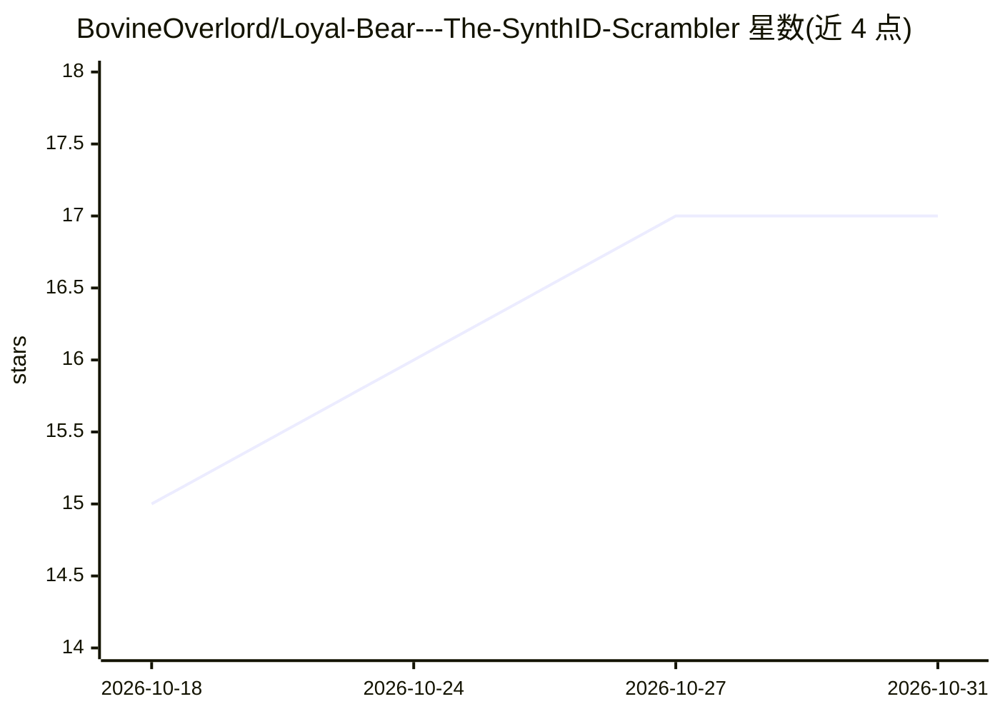

# BovineOverlord/Loyal-Bear---The-SynthID-Scrambler

⭐ 17 · Python · NOASSERTION · 推送 2026-08-22 · [GitHub](https://github.com/BovineOverlord/Loyal-Bear---The-SynthID-Scrambler) · 个人维护

**从 AI 生成图像中移除 SynthID 隐形水印的工具**

针对 OpenAI 与 Gemini 生成图像中的 SynthID 隐形水印的清除工具：作者称其他同类工具未能实际解决，本工具通过打乱像素中的水印与追踪模式实现移除，且对图像损伤较小。首次运行时自动安装 Python 依赖并下载约 6.9 GB 的模型，后续启动即时运行。要求 Python 3.10+ 与 8GB 内存；Windows 版经过测试，Linux 版未测试。作者声明禁止企业及企业代理使用，并保留大部分实现方法不公开。

## 筛选速览

| 维度 | 判定 | 备注 |
|---|---|---|
| AI 角色 | `ai-native` | 本体是模型或模型工具 |
| 许可风险 | `none` | NOASSERTION |
| 部署形态 | `library` | 以包/库形式分发 |
| 模型依赖 | — | README 未给出锁定关系 |
| 硬件要求 | — | 无带数字的原话,不猜 |
| 安装摩擦 | `low` | 无编译、无系统依赖或容器化 |
| 成熟度 | `idea` | |

## 能力要点

- 作用于 OpenAI 与 Gemini 生成的图像（截至 2026 年 7 月）
- 首次启动自动安装依赖并下载约 6.9 GB 模型
- 方法部分保密，作者称内置监测篡改尝试的机制

## 适用场景

- 移除 AI 生成图像中的 SynthID 水印与追踪模式
- 个人或商业用途的图像处理（作者许可条款下）

## 场景标签

`图像视频处理` · 领域:感知与多模态

## 证据(README 行号)

> L7: Corporations continue to exert control over AIs under the guise of "safety". Their recent intrusion into the AI imag
> L9: Upon discovering that other SynthID removal tools do not actually fix this, I created my own. It works on all OpenAI

## 星数曲线

2026-10-18 15 → 2026-10-31 17（+2）

---
*卡片 v1 · prompt 1.4 · 生成 2026-10-30 · 置信度 mid · 依据 README sha `ca7558c0271c` · [字段定义](../../DATASET.md)*
