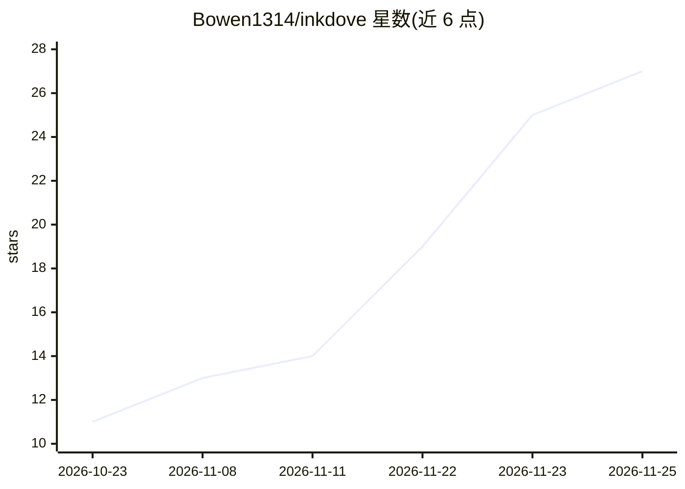

# Bowen1314/inkdove

⭐ 27 · JavaScript · AGPL-3.0 · 推送 2026-11-21 · [GitHub](https://github.com/Bowen1314/inkdove) · 个人维护 · 中文 README

**给外贸团队的 WhatsApp/LINE/Telegram 工作台，AI 依知识库起草回复**

自托管的多渠道客户沟通工作台：公司号码统一对外，管理员将客户分配给业务员并支持离职转交。AI 部分包括按需的「推荐回复」——经 RAG（默认全文检索，可选向量检索存于内置 SQLite）从知识库取依据起草，标注【待你确认】并由人工修改后发送；另有首页只读 AI 助手（function calling 查询数据）、翻译、语音图片转文字、客户线索提取与可选自动回复（四层校验）。经 Docker Compose 部署，需一个大模型 API key（OpenAI/Anthropic/Gemini 三种接口格式）。

## 筛选速览

| 维度 | 判定 | 备注 |
|---|---|---|
| AI 角色 | `ai-native` | 本体是模型或模型工具 |
| 许可风险 | `viral` | AGPL-3.0 |
| 部署形态 | `self-host` | docker 或自建部署 |
| 模型依赖 | local-ok | 支持本地模型 |
| 硬件要求 | — | 无带数字的原话,不猜 |
| 安装摩擦 | `low` | 无编译、无系统依赖或容器化 |
| 成熟度 | — | 结构信号不足 |

## 能力要点

- AI 起草回复经 RAG 检索知识库，人工确认后发送
- 向量检索内置于 SQLite，无需另部署向量数据库，支持 OpenAI/Gemini/本机 Ollama
- 六种号码接入方式：WhatsApp 扫码/Meta Cloud API、LINE 官方帐号、Telegram 三种
- 客户分配、离职转交、操作日志、屏蔽词与数据看板

## 适用场景

- 外贸团队多人共用公司 WhatsApp 帐号与客户沟通
- 新员工按公司统一产品资料和话术回复客户
- 业务员用中文写回复后一键翻译为客户语言发送
- 管理者查看全部聊天并审计对外沟通行为

## 场景标签

`AI 助手` `RAG` `聊天机器人` · 领域:对话与助手

## 证据(README 行号)

> L5: **面向外贸团队的 WhatsApp、LINE 与 Telegram 工作台：公司号码统一对外，客户分配给业务员；需要时由 AI 通过 RAG（全文检索 + 内置向量库）从知识库检索依据、起草回复，经人工确认后发送。**
> L43: - **AI 按需起草，人工确认后发送。** 在会话页点击「推荐回复」，AI 结合上下文和知识库起草一条回复：资料中写明的标准交期、起订量、样品政策直接引用；需要人工决定的内容（折扣、具体发货日期、按量报价等）标注为【待你确认：…
> L45: - **RAG 检索，可选向量检索。** AI 回复前先从知识库中检索与客户问题相关的条目，仅将这些条目提供给模型（RAG）：默认通过全文索引按关键词检索；客户语言与知识库语言不同时，先将客户的问题改写为知识库的语言再检索。在设置

## 星数曲线

2026-10-23 11 → 2026-11-25 27（+16）

---
*卡片 v1 · prompt 1.4 · 生成 2026-11-18 · 置信度 high · 依据 README sha `889fc2763859` · [字段定义](../../DATASET.md)*
