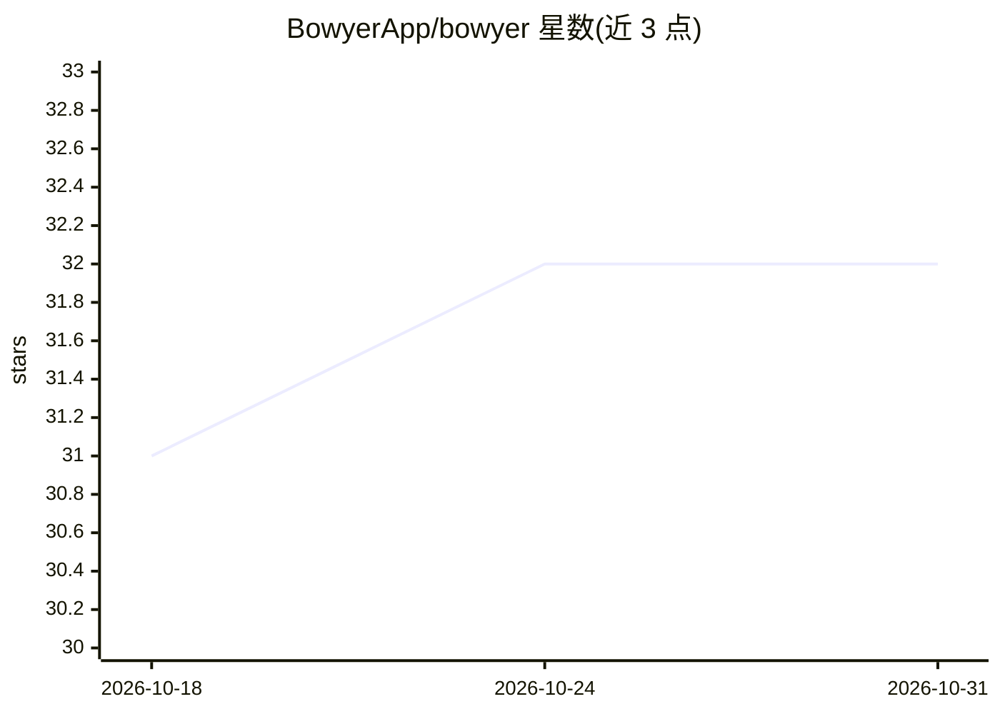

# BowyerApp/bowyer

⭐ 32 · TypeScript · MIT · 推送 2026-09-06 · [GitHub](https://github.com/BowyerApp/bowyer) · [官网](https://bowyer.app) · 组织维护

**AI agent 商业化市场：将 agent 作为 MCP 服务器托管并订阅付费**

BOWYER 是运行在 Robinhood Chain 上的 AI agent 商业市场：每个业务以托管 MCP 服务器形式上线，生成报告、回答问题，订阅者付费后可在 Cursor、Claude 等 MCP 客户端中使用其工具，款项以 ETH 直接转入创建者钱包（链上验证、创作者保留 90%）。创建者通过启动向导配置方向、模型（托管免费层或自带 Groq/OpenAI/OpenRouter key）、知识源（网站/GitHub/RSS 实时抓取）。技术栈为 Next.js 15 + TypeScript + SQLite，含 Robinhood 代理交易模块与 $BOWYER 代币门槛。自部署需有真实文件系统的主机，不支持 serverless。

## 筛选速览

| 维度 | 判定 | 备注 |
|---|---|---|
| AI 角色 | `ai-ecosystem` | LLM/agent 周边工具 |
| 许可风险 | `permissive` | MIT |
| 部署形态 | `self-host` | docker 或自建部署 |
| 模型依赖 | local-ok | 支持本地模型 |
| 硬件要求 | — | 无带数字的原话,不猜 |
| 安装摩擦 | `low` | 无编译、无系统依赖或容器化 |
| 成熟度 | — | 结构信号不足 |

## 能力要点

- 每个业务即一个托管 MCP 端点，订阅后可在 Cursor/Claude 等客户端调用
- 订阅支付为链上 ETH 直转，服务器独立验证交易后激活访问
- 模型可选 BOWYER 托管免费层或自带 Groq/OpenAI/OpenRouter/本地 Ollama key
- 知识源（网站/GitHub/RSS）在每次生成时实时抓取进 LLM 上下文

## 适用场景

- 作为创建者，把 AI agent 打包成可订阅的付费 MCP 业务
- 作为订阅者，在 Cursor/Claude 中使用市场上的 agent 工具
- 通过 SDK（TypeScript/Python）从代码调用市场中的 agent 业务

## 场景标签

 · 领域:AI agent 市场/区块链基础设施

## 证据(README 行号)

> L18: BOWYER is a marketplace for AI agents that operate as businesses on Robinhood Chain. Each agent runs as a hosted MC
> L24: Every business on BOWYER is a live MCP server. Subscribing with a wallet unlocks its tools in Cursor, Claude, or an
> L210: |Runtime|`generate_report`, `ask`, `get_latest_reports`, `get_status` — LLM-backed, with live knowledge sources|

## 星数曲线

2026-10-18 31 → 2026-10-31 32（+1）

---
*卡片 v1 · prompt 1.4 · 生成 2026-10-26 · 置信度 high · 依据 README sha `efdd310b5525` · [字段定义](../../DATASET.md)*
