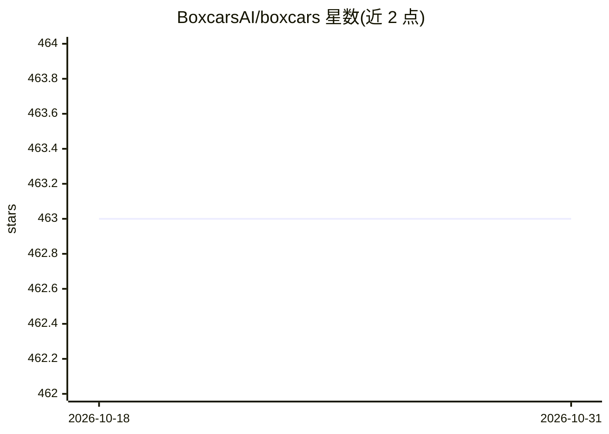

# BoxcarsAI/boxcars

⭐ 463 · Ruby · MIT · 推送 2026-10-13 · [GitHub](https://github.com/BoxcarsAI/boxcars) · 组织维护

**Ruby/Rails 团队构建 LLM 应用的组合式框架**

Boxcars 是一个 Ruby gem，为 Ruby 和 Rails 开发者提供构建 LLM 驱动系统的框架：以 Boxcar（单一用途工具）、Train（多工具编排，含 ReAct 与原生 tool calling 两种模式）、Engine（接 OpenAI/Anthropic/Groq/Gemini/Ollama 等多家提供商）为核心编程模型，并支持 JSON Schema 结构化输出、MCP 服务器集成、向量存储与 SQL/ActiveRecord 数据工具。ActiveRecord 与 SQL 工具默认只读模式，拒绝写操作。设计上受 LangChain 启发，要求 Ruby 3.3+。

## 筛选速览

| 维度 | 判定 | 备注 |
|---|---|---|
| AI 角色 | `ai-ecosystem` | LLM/agent 周边工具 |
| 许可风险 | `permissive` | MIT |
| 部署形态 | `None` |  |
| 模型依赖 | local-ok | 支持本地模型 |
| 硬件要求 | — | 无带数字的原话,不猜 |
| 安装摩擦 | `low` | 无编译、无系统依赖或容器化 |
| 成熟度 | — | 结构信号不足 |

## 能力要点

- Boxcar/Train/Engine 一致的编程模型，支持 ReAct 与原生 tool calling 两种编排
- Engine 支持 OpenAI、Anthropic、Groq、Gemini、Ollama 等多家提供商
- 通过 stdio 连接 MCP 服务器并将 MCP 工具与本地 Boxcar 合并
- ActiveRecord/SQL 工具默认只读，写操作需显式关闭或提供审批回调

## 适用场景

- 构建能查 SQL/ActiveRecord 数据并检索文档的内部 copilot
- 组合搜索、计算、API 调用工具完成多步操作的运维机器人
- 将自有 Ruby 工具与 MCP 发现的工具混合的本地+远程 agent 工作流

## 场景标签

`Agent 框架` · 领域:Agent 开发

## 证据(README 行号)

> L9: Boxcars is a Ruby framework for building LLM-powered systems with less cognitive load, especially for Ruby and Rails
> L36: - **Boxcar** — a single-purpose tool (search, math, SQL, Active Record query, API call). Can use an Engine for LLM 
> L39: - **Engine** — generates text from a Prompt. Supports OpenAI, Anthropic, Groq, Gemini, Perplexity, Ollama, Together

## 星数曲线

2026-10-18 463 → 2026-10-31 463（+0）

---
*卡片 v1 · prompt 1.4 · 生成 2026-10-21 · 置信度 high · 依据 README sha `ff4a99fe2473` · [字段定义](../../DATASET.md)*
