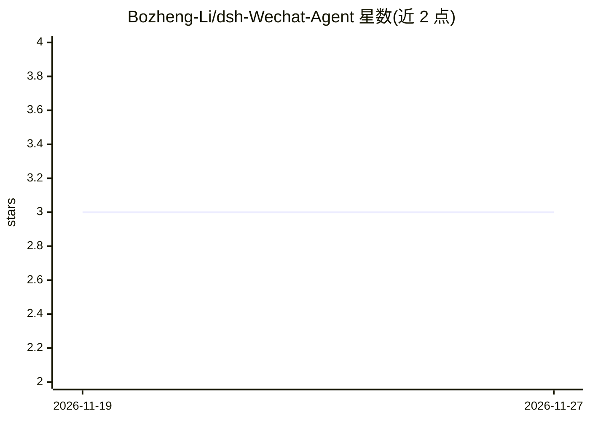

# Bozheng-Li/dsh-Wechat-Agent

⭐ 3 · JavaScript · AGPL-3.0 · 推送 2026-11-22 · [GitHub](https://github.com/Bozheng-Li/dsh-Wechat-Agent) · [官网](https://www.npmjs.com/package/dsh-plugin-wechat-agent) · 个人维护 · 中文 README

**把 DeepSeek Harness 助手接入微信的插件：聊天、记忆、任务与朋友圈自动化**

一个 DSH（DeepSeek Harness）插件，为微信提供接入层：授权私聊/群聊的自然聊天、人设库与人物卡记忆管理、通过微信委托 DSH 执行工作任务并回传成果、定时提醒与群聊简报、朋友圈草稿生成与自动发布互动、表情图片管理与可选生图搜索接口。完整安装包含微信认证组件与固定版本依赖，仅支持 Windows x64；新装默认关闭自动回复与朋友圈自动化，需先安装配置 DeepSeek Harness 本体。

## 筛选速览

| 维度 | 判定 | 备注 |
|---|---|---|
| AI 角色 | `ai-native` | 本体是模型或模型工具 |
| 许可风险 | `viral` | AGPL-3.0 |
| 部署形态 | `None` |  |
| 模型依赖 | locked-api |  |
| 硬件要求 | — | 无带数字的原话,不猜 |
| 安装摩擦 | `low` | 无编译、无系统依赖或容器化 |
| 成熟度 | `idea` | |

## 能力要点

- 通过 DSH 插件管理页或自定义插件市场安装，npm 与 GitHub Releases 提供完整安装包
- 人设库最多 12 条，支持从授权聊天提炼语言档案与试聊；人物卡按微信身份归档
- /work 命令与自然语言委托 DSH 工作任务，支持新建、继续、并行、查询和取消
- 朋友圈从素材到草稿生成、计划发布与自动互动，全程遵循对象授权机制

## 适用场景

- 让 AI 助手在授权的微信私聊和群聊中代为回复
- 通过微信消息远程委托本机执行工作任务并取回成果
- 定时提醒、群聊简报等微信自动化运营
- 管理朋友圈素材、草稿与定时发布

## 场景标签

`AI 助手` `聊天机器人` `工作流自动化` · 领域:效率与自动化

## 证据(README 行号)

> L3: 把 DSH 助手接入微信：自然聊天、记住已授权的人、执行工作任务，并管理提醒与朋友圈。
> L23: |自然聊天|授权私聊可直接提问；群聊支持 @、昵称唤醒和统一的参与模式，可分别开启新消息、冷场和连续接话机会；模型可按本轮决定回复或跳过。|
> L25: |工作任务|已授权管理员通过微信委托 DSH 执行工作；支持新建、继续、并行、查询和取消，回传文字、图片与本机文件成果。|

## 星数曲线

2026-11-19 3 → 2026-11-27 3（+0）

---
*卡片 v1 · prompt 1.4 · 生成 2026-11-22 · 置信度 high · 依据 README sha `c600dd56fe40` · [字段定义](../../DATASET.md)*
