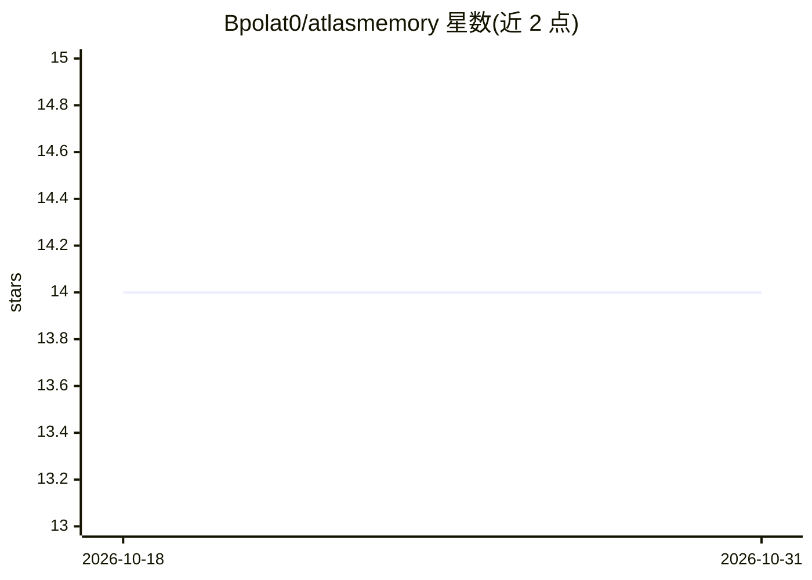

# Bpolat0/atlasmemory

⭐ 14 · TypeScript · GPL-3.0 · 推送 2026-04-05 · [GitHub](https://github.com/Bpolat0/atlasmemory) · [官网](https://www.npmjs.com/package/atlasmemory) · 个人维护 · 中文 README

**给 AI 编码代理的代码库证据化记忆 MCP 工具**

面向 AI 编码代理的 MCP 服务器与 CLI，为本机代码库建立带证据锚点的记忆：每个声明关联到行号区间与内容哈希，代码变更时锚点被标记为过期；通过 Tree-sitter 对 11 种语言做 AST 解析，提供 28 个 MCP 工具（搜索、上下文构建、决策记录、跨会话记忆等），并生成按 token 预算裁剪的上下文包。本地运行、无需 API key；可选的语义增强步骤需本机 Claude CLI 或 OpenAI Codex 订阅。通过 npx 安装，支持 Claude Desktop、Cursor、VS Code 等客户端接入，另有 VS Code 扩展提供可视化面板。

## 筛选速览

| 维度 | 判定 | 备注 |
|---|---|---|
| AI 角色 | `ai-ecosystem` | LLM/agent 周边工具 |
| 许可风险 | `viral` | GPL-3.0 |
| 部署形态 | `library` | 以包/库形式分发 |
| 模型依赖 | — | README 未给出锁定关系 |
| 硬件要求 | — | 无带数字的原话,不猜 |
| 安装摩擦 | `low` | 无编译、无系统依赖或容器化 |
| 成熟度 | — | 结构信号不足 |

## 能力要点

- 声明级证据锚（行号区间+内容哈希），代码变更即标记过期
- Tree-sitter AST 解析，支持 11 种语言
- 28 个 MCP 工具：搜索、上下文构建、决策记录、跨会话记忆
- token 预算化的上下文包（TaskPack）与 CLAUDE.md 自动生成

## 适用场景

- 让 Claude/Cursor 等 AI 编码代理在大型代码库中带证据检索与理解代码
- 跨会话保留项目决策与架构记忆，避免上下文丢失
- 压缩上下文窗口占用，按预算构建代码库上下文包

## 场景标签

`Agent 记忆` · 领域:Agent 开发

## 证据(README 行号)

> L19:  Give your AI agent evidence-backed memory for your entire codebase.
> L137: { "mcpServers": { "atlasmemory": { "command": "npx", "args": ["-y", "atlasmemory"] } } }
> L231: ## MCP Tools (28 total)

## 星数曲线

2026-10-18 14 → 2026-10-31 14（+0）

---
*卡片 v1 · prompt 1.4 · 生成 2026-10-31 · 置信度 high · 依据 README sha `8ffd6f83e29c` · [字段定义](../../DATASET.md)*
