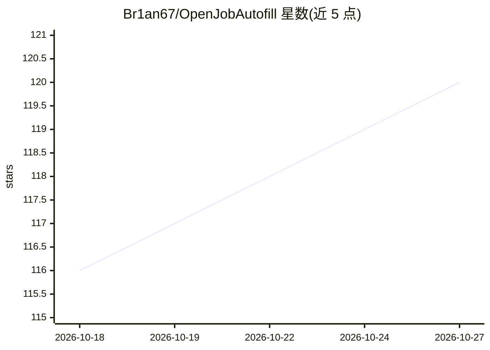

# Br1an67/OpenJobAutofill

⭐ 120 · JavaScript · MIT · 推送 2026-05-13 · [GitHub](https://github.com/Br1an67/OpenJobAutofill) · 个人维护 · 中文 README

**隐私优先的网申表单自动填写浏览器扩展，AI 可选辅助字段理解**

面向求职者的 Chrome/Brave 浏览器扩展：用户在本机维护简历资料（个人信息、教育、实习、项目、证书、奖项），打开招聘网站点击开始填写后，扩展扫描页面并用本地规则填写可确定的字段，不确定的标为橙色待处理。AI 为可选功能：不配置 API 时仍可用本地规则匹配；配置 OpenAI 兼容接口后用于理解不同网站字段含义，且 AI 请求只包含字段名称，不包含简历具体值。以开发者模式加载未打包目录安装，无需构建，最终提交由用户人工完成。

## 筛选速览

| 维度 | 判定 | 备注 |
|---|---|---|
| AI 角色 | `ai-enhanced` | 去掉 AI 部分产品仍成立 |
| 许可风险 | `permissive` | MIT |
| 部署形态 | `None` |  |
| 模型依赖 | — | README 未给出锁定关系 |
| 硬件要求 | — | 无带数字的原话,不猜 |
| 安装摩擦 | `low` | 无编译、无系统依赖或容器化 |
| 成熟度 | — | 结构信号不足 |

## 能力要点

- 简历资料仅保存在本机，不上传云端
- AI 请求只含字段名称，不含简历具体值
- 绿色/橙色双色标记区分已填写与待处理字段
- 支持 OpenAI 兼容 API 及自定义 Base URL、路径和模型名

## 适用场景

- 反复填写网申表单时先自动填一遍，再人工复核提交
- 用资料面板按分类搜索并手动处理复杂控件字段
- 换浏览器或电脑时通过备份文件迁移简历资料

## 场景标签

`浏览器自动化` · 领域:效率与自动化

## 证据(README 行号)

> L7: OpenJobAutofill 是一个带 AI 页面分析能力的网申表单填写扩展。你只需要在本机维护一份简历资料，之后打开招聘网站，点击 `开始填写`，它会扫描当前页面，用本地规则和可选 AI 理解字段含义，把能确定的内容填进表单，其
> L53: AI 是可选的。不配置 API 时，OpenJobAutofill 仍会使用本地规则尝试匹配和填写字段。

## 星数曲线

2026-10-18 116 → 2026-10-27 120（+4）

---
*卡片 v1 · prompt 1.4 · 生成 2026-10-23 · 置信度 high · 依据 README sha `1c3a4b8cdaeb` · [字段定义](../../DATASET.md)*
