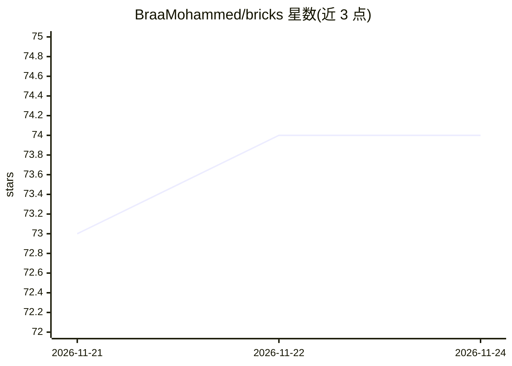

# BraaMohammed/bricks

⭐ 74 · TypeScript · 推送 2026-11-23 · [GitHub](https://github.com/BraaMohammed/bricks) · [官网](https://usebricks.xyz) · 个人维护

**本地自托管的 Clay.com 替代表格：数据 enrichment 与外联自动化**

以数据表格为核心的本地运行工具，每列可编程为 AI prompt、自主网络搜索 agent、Puppeteer 脚本或 JavaScript 公式。内置双 agent 外联循环（writer 起草、prospect 扮演目标客户审阅直至通过）、邮箱模式生成与多级验证 API 级联、本地 Puppeteer 隐身浏览器池。后端提供 OpenAI 兼容网关 /api/ai/v1，跨 6 个免费档推理服务商做瀑布式 failover。需 Node.js 18+，前端已托管、后端需本地运行，并需修改浏览器本地网络设置。

## 筛选速览

| 维度 | 判定 | 备注 |
|---|---|---|
| AI 角色 | `ai-native` | 本体是模型或模型工具 |
| 许可风险 | `none` | — |
| 部署形态 | `library` | 以包/库形式分发 |
| 模型依赖 | local-ok | 支持本地模型 |
| 硬件要求 | — | 无带数字的原话,不猜 |
| 安装摩擦 | `low` | 无编译、无系统依赖或容器化 |
| 成熟度 | — | 结构信号不足 |

## 能力要点

- 列级可编程：AI prompt、搜索 agent、Puppeteer 脚本、JS 公式
- writer/prospect 双 agent 循环生成外联文案
- OpenAI 兼容网关跨 6 个免费档服务商自动 failover
- Puppeteer 隐身浏览器池与网络层屏蔽 30+ 追踪域名

## 适用场景

- 上传 CSV 批量做公司/线索数据 enrichment
- 无第三方邮件工具时查找并验证线索邮箱
- 生成经 persona 压测的外联消息

## 场景标签

`浏览器自动化` `网页抓取` `AI 写作` `模型网关` · 领域:Agent 开发

## 证据(README 行号)

> L9: Bricks runs the same workflows — web scraping, AI agents, browser automation, data synthesis — entirely on your own 
> L16: Bricks spins up a search agent that creates queries, hits the `/api/search` and `/api/reader` backend endpoints, re

## 星数曲线

2026-11-21 73 → 2026-11-24 74（+1）

---
*卡片 v1 · prompt 1.4 · 生成 2026-11-21 · 置信度 high · 依据 README sha `6e4bfbcbef49` · [字段定义](../../DATASET.md)*
