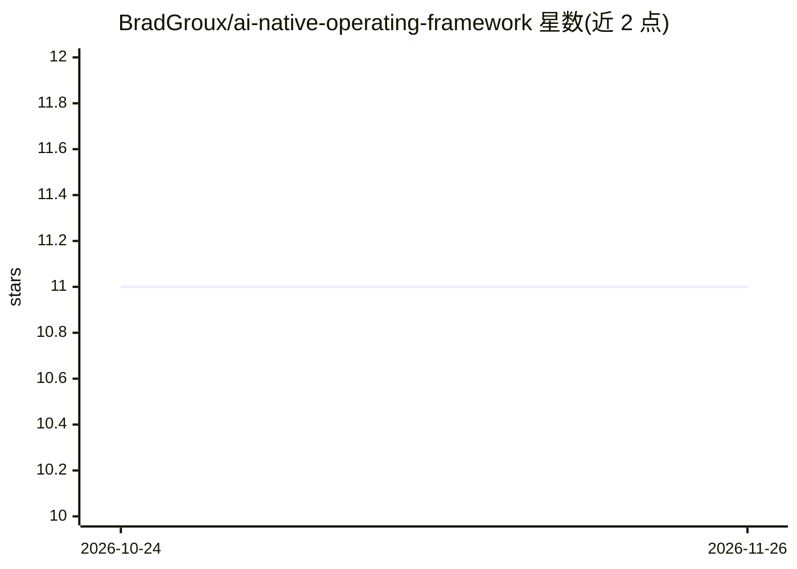

# BradGroux/ai-native-operating-framework

⭐ 11 · Python · MIT · 推送 2026-09-05 · [GitHub](https://github.com/BradGroux/ai-native-operating-framework) · 组织维护

**企业与 AI 协作的标准化运营框架与 SOP 方法**

一套开源的商业运营框架与方法，用于定义、记录、应用和改进人与 AI 共同执行工作时的标准与流程（SOP）。内容以文档形式组织：章程、运营框架、SOP 内容标准、共享运营记忆标准、维护方法与术语表，附 11 个业务流程示例（标注为 Illustrative、未经领域验证）。明确不规定软件、schema 或 agent harness。采用 MIT 许可，仓库提供校验脚本与治理、决策记录、贡献流程等文档。

## 筛选速览

| 维度 | 判定 | 备注 |
|---|---|---|
| AI 角色 | `ai-knowledge` | 知识聚合/清单类 |
| 许可风险 | `permissive` | MIT |
| 部署形态 | `None` |  |
| 模型依赖 | — | README 未给出锁定关系 |
| 硬件要求 | — | 无带数字的原话,不猜 |
| 安装摩擦 | `low` | 无编译、无系统依赖或容器化 |
| 成熟度 | — | 结构信号不足 |

## 能力要点

- 章程 + 运营框架 + SOP 内容标准 + 共享运营记忆标准的文档体系
- 11 个业务流程示例（Illustrative，需组织授权与领域审查后使用）
- scripts/validate-repository.sh 提供文档与元数据一致性校验
- MIT 许可，附 CITATION.cff 引用元数据与治理/决策记录

## 适用场景

- 为团队制定人与 AI 共同遵循的业务 SOP 与责任边界
- 建立跨会话留存的组织运营记忆规范
- 参考示例了解框架在业务流程中的落地方式

## 场景标签

 · 领域:商业运营/知识管理

## 证据(README 行号)

> L3: An open business operating framework and method for defining, documenting,
> L41: 1. Charter
> L144: - People and AI use the same approved business standards and SOPs.

## 星数曲线

2026-10-24 11 → 2026-11-26 11（+0）

---
*卡片 v1 · prompt 1.4 · 生成 2026-11-19 · 置信度 high · 依据 README sha `30f5a42d1418` · [字段定义](../../DATASET.md)*
