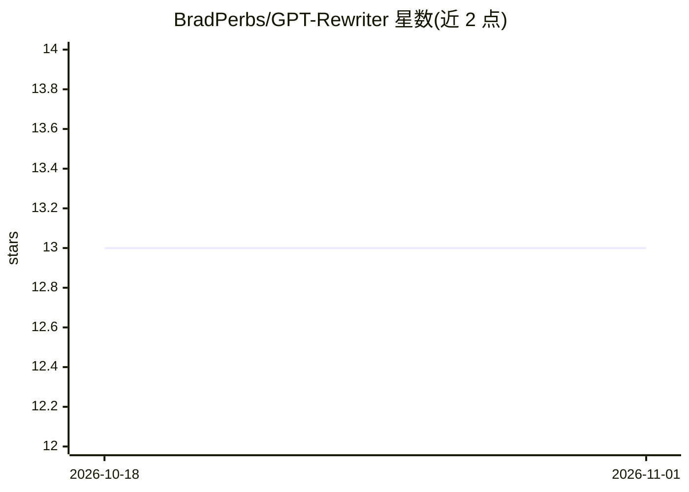

# BradPerbs/GPT-Rewriter

⭐ 13 · PHP · MIT · 推送 2026-05-01 · [GitHub](https://github.com/BradPerbs/GPT-Rewriter) · 个人维护

**WordPress 插件：用 GPT-3.5 自动改写草稿文章并定时发布**

面向 WordPress 用户的文章改写插件：通过 ChatGPT API 将草稿文章发送至 GPT-3.5 生成改写版本，改写结果以新文章形式保存，原草稿不受影响；支持改写风格、字数等自定义设置，以及定时发布安排。安装方式为从 Releases 下载 zip 后经 WordPress 后台上传启用，需用户自行在 OpenAI 获取 API key 并填入插件设置，API 调用费用由用户按 OpenAI 定价承担。

## 筛选速览

| 维度 | 判定 | 备注 |
|---|---|---|
| AI 角色 | `ai-native` | 本体是模型或模型工具 |
| 许可风险 | `permissive` | MIT |
| 部署形态 | `desktop` | 安装包/桌面程序 |
| 模型依赖 | — | README 未给出锁定关系 |
| 硬件要求 | — | 无带数字的原话,不猜 |
| 安装摩擦 | `low` | 无编译、无系统依赖或容器化 |
| 成熟度 | — | 结构信号不足 |

## 能力要点

- 调用 ChatGPT API 改写 WordPress 草稿文章
- 改写生成新文章，保留原草稿
- 可设置改写风格、字数等参数
- 支持定时发布改写后的文章

## 适用场景

- 自动改写我积累的 WordPress 草稿并发布
- 按自定义风格批量生成文章变体
- 维持固定的内容发布日程

## 场景标签

`AI 写作` · 领域:内容生成

## 证据(README 行号)

> L5: The ChatGPT AutoRewrite Plugin is a powerful tool that leverages the OpenAI GPT-3.5 architecture to automatically re
> L45: 3. The plugin will send the draft to the ChatGPT API, which will generate a rewritten version.

## 星数曲线

2026-10-18 13 → 2026-11-01 13（+0）

---
*卡片 v1 · prompt 1.4 · 生成 2026-10-31 · 置信度 high · 依据 README sha `af1ad63c7fa7` · [字段定义](../../DATASET.md)*
