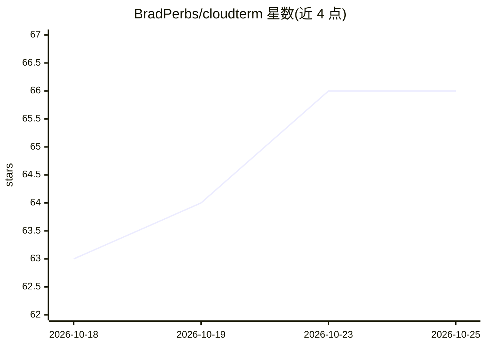

# BradPerbs/cloudterm

⭐ 66 · JavaScript · NOASSERTION · 推送 2026-09-21 · [GitHub](https://github.com/BradPerbs/cloudterm) · [官网](https://cloudblast.io/terminal) · 组织维护 · 中文 README

**集成 AI agent 的多协议终端：SSH/SFTP/Telnet/RDP 同窗**

基于 Electron、React 和 xterm.js 构建的终端工作区，在一个窗口内提供 SSH/Telnet/串口终端、SFTP 文件传输、端口转发、RDP/VNC 远程桌面、跳板机、代理与加密密钥库，并支持免费云同步。侧栏 AI agent 可读取当前会话画面、在可见终端中执行命令，驱动本机已安装的 CLI（Claude Code、Codex、OpenCode、Grok Build、Kimi Code），也支持接入本地模型（LM Studio、Ollama、llama.cpp 等任意 OpenAI 兼容端点）；执行变更前会询问，支持允许列表与本地加密凭证库。由 VPS 托管公司 CloudBlast 开发，fair-code 许可。

## 筛选速览

| 维度 | 判定 | 备注 |
|---|---|---|
| AI 角色 | `ai-enhanced` | 去掉 AI 部分产品仍成立 |
| 许可风险 | `none` | NOASSERTION |
| 部署形态 | `library` | 以包/库形式分发 |
| 模型依赖 | local-ok | 支持本地模型 |
| 硬件要求 | — | 无带数字的原话,不猜 |
| 安装摩擦 | `low` | 无编译、无系统依赖或容器化 |
| 成熟度 | — | 结构信号不足 |

## 能力要点

- SSH/SFTP/Telnet/串口/RDP/VNC 多协议集成于单一窗口
- AI agent 读取当前会话并在可见终端中代执行命令，支持 Claude Code/Codex/OpenCode/Grok Build/Kimi Code 及本地模型
- 执行前询问机制与命令允许列表，凭证本地加密存储
- 免费云同步（本机加密后上传）与跨平台安装包

## 适用场景

- 在一个窗口里管理 SSH 会话、传文件和连 Windows 远程桌面
- 让 AI agent 读取屏幕上的报错并直接在会话中排查服务器问题
- 用本地模型驱动终端助手，数据不出本机

## 场景标签

`AI 助手` · 领域:对话与助手

## 证据(README 行号)

> L59: - **An AI agent** in a panel beside the terminal, which reads the session you
> L67: Pick the agent you already have. CloudTerm drives the CLI on your machine under

## 星数曲线

2026-10-18 63 → 2026-10-25 66（+3）

---
*卡片 v1 · prompt 1.4 · 生成 2026-10-24 · 置信度 high · 依据 README sha `9515cc9eab73` · [字段定义](../../DATASET.md)*
