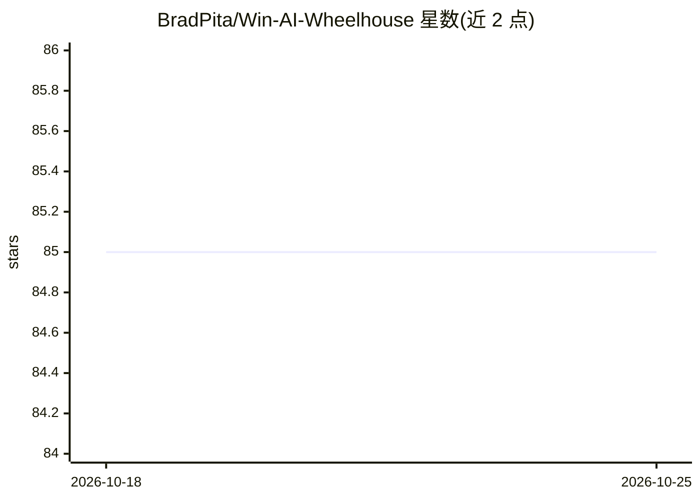

# BradPita/Win-AI-Wheelhouse

⭐ 85 · MIT · 推送 2026-10-24 · [GitHub](https://github.com/BradPita/Win-AI-Wheelhouse) · [官网](https://huggingface.co/BradPita/Win-AI-Wheelhouse) · 个人维护 · 中文 README

**Windows 平台 AI 库预编译 wheel 聚合目录，免编译即装**

面向 Windows AI 开发者的预编译 Python wheel 合集：通过 GitHub Actions 自动抓取并按版本、Python/PyTorch/CUDA 版本、CXX11 ABI 结构化整理 PyTorch、Flash Attention、xformers、SageAttention、Nunchaku、Triton 等库的社区编译产物，来源聚合自 Wildminder、lldacing、mjun0812 等多个贡献者。使用方式为在表格中找到匹配行后用 pip 直链安装。项目自述为个人学习实践项目，延续 wildminder AI-windows-whl 的思路；CXX11 ABI 不匹配会导致崩溃，README 提供了检测与选择指南。

## 筛选速览

| 维度 | 判定 | 备注 |
|---|---|---|
| AI 角色 | `ai-knowledge` | 知识聚合/清单类 |
| 许可风险 | `permissive` | MIT |
| 部署形态 | `library` | 以包/库形式分发 |
| 模型依赖 | — | README 未给出锁定关系 |
| 硬件要求 | — | 无带数字的原话,不猜 |
| 安装摩擦 | `medium` | 含编译或系统依赖之一 |
| 成熟度 | — | 结构信号不足 |

## 能力要点

- GitHub Actions 定期自动抓取并更新 wheel 链接
- 按 Python/PyTorch/CUDA 版本与 CXX11 ABI 元数据结构化组织条目
- 聚合 Wildminder、lldacing、mjun0812 等多来源社区编译产物
- 提供 pip 直链安装方式与 CXX11 ABI 一致性检测代码

## 适用场景

- 在 Windows 上免编译安装 Flash Attention 等需本地编译的库
- 为 ComfyUI/Stable Diffusion 环境匹配特定 PyTorch+CUDA 版本的 wheel
- 按 CXX11 ABI 列挑选与本地 PyTorch 兼容的版本

## 场景标签

`精选清单` · 领域:学习与行业

## 证据(README 行号)

> L5:  面向 Windows 平台的 AI 预编译 Python 轮子合集
> L41: 本项目作为一个**学习和实践的项目**，在延续 wildminder AI-windows-whl 优秀理念的基础上，尝试通过以下方式提供一些补充：

## 星数曲线

2026-10-18 85 → 2026-10-25 85（+0）

---
*卡片 v1 · prompt 1.4 · 生成 2026-10-24 · 置信度 mid · 依据 README sha `fbebf8148774` · [字段定义](../../DATASET.md)*
