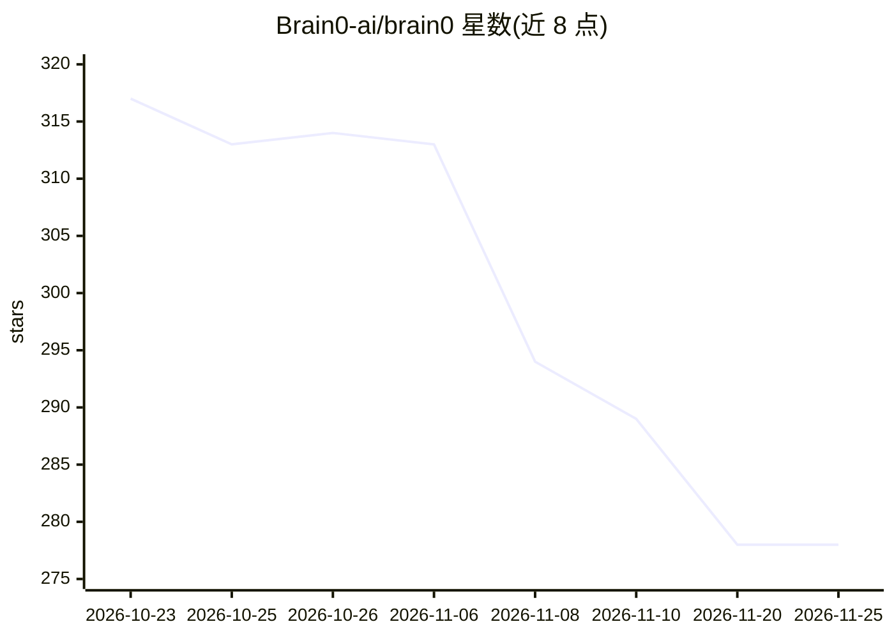

# Brain0-ai/brain0

⭐ 278 · Rust · Apache-2.0 · 推送 2026-11-10 · [GitHub](https://github.com/Brain0-ai/brain0) · 组织维护

**为 AI 编码代理的提交建立决策图谱与审计的开发者工具**

以纯观察者方式读取 git 历史与编码代理（Codex/Claude Code）已写入磁盘的会话记录，构建提交↔意图的决策图谱：提供漂移检测（声明 vs 实际改动）、代理读取文件的 DLP 敏感读审计、二维风险评分、Ed25519/in-toto 签名溯源证明。默认离线运行，本地嵌入与摘要；可选 Ollama 或托管 LLM。附 MCP 查询通道与本地 GUI。需 Node.js ≥ 20，经 npx 运行；Rust 源码可自行构建。

## 筛选速览

| 维度 | 判定 | 备注 |
|---|---|---|
| AI 角色 | `ai-ecosystem` | LLM/agent 周边工具 |
| 许可风险 | `permissive` | Apache-2.0 |
| 部署形态 | `library` | 以包/库形式分发 |
| 模型依赖 | local-ok | 支持本地模型 |
| 硬件要求 | `gpu-8g` | |
| 安装摩擦 | `low` | 无编译、无系统依赖或容器化 |
| 成熟度 | — | 结构信号不足 |

## 能力要点

- 提交与代理提示词的被动关联，无需钩子或代理配合
- DLP 审计代理读取内容并在摄入时做密钥脱敏
- MCP 工具（context/blame/debug/audit）供编码代理查询
- 默认离线：本地特征哈希嵌入 + Ollama 可选本地模型

## 适用场景

- 追溯某行代码由哪个代理提示写入
- 审计代理会话是否读取过 .env 或私钥
- 每日排查代理改动的风险与漂移
- 通过 MCP 给编码代理提供带溯源的上下文

## 场景标签

`代码审查` `LLM 可观测性` `网络安全` · 领域:编码与开发

## 证据(README 行号)

> L22: brain0 **passively** builds a decision graph of your repository: every **commit** linked to
> L126: The same graph is a query channel your coding agent can call **before touching code**:
> L162: 5. **Open source and composable**: bring your own database and your own LLM keys, or run fully offline.

## 星数曲线

2026-10-23 317 → 2026-11-25 278（-39）

---
*卡片 v1 · prompt 1.4 · 生成 2026-11-25 · 置信度 high · 依据 README sha `8ca85a30755d` · [字段定义](../../DATASET.md)*
