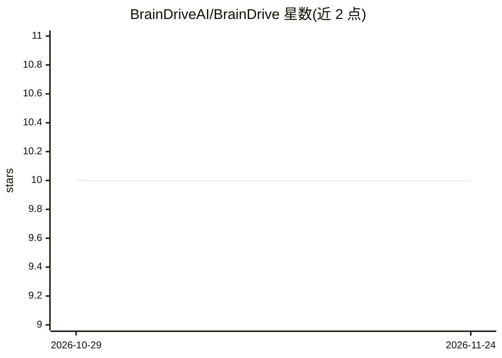

# BrainDriveAI/BrainDrive

⭐ 10 · TypeScript · MIT · 推送 2026-11-23 · [GitHub](https://github.com/BrainDriveAI/BrainDrive) · [官网](https://braindrive.ai) · 组织维护

**自托管的个人 AI 系统：帮用户设定并达成人生目标**

自托管、MIT 许可的个人 AI 系统，通过访谈理解用户目标，生成结构化 spec 与行动计划，并随持续对话积累本地记忆（Your Memory）以跟进进展。内置职业、关系、健身、财务等领域项目，支持记忆快照备份到 Git 仓库。以两个 Docker 容器运行（应用服务器 + 边缘代理），支持云端 API 模型与本地 Ollama 模型，提供 Tailscale 远程访问。当前处于 beta 阶段。

## 筛选速览

| 维度 | 判定 | 备注 |
|---|---|---|
| AI 角色 | `ai-native` | 本体是模型或模型工具 |
| 许可风险 | `permissive` | MIT |
| 部署形态 | `desktop` | 安装包/桌面程序 |
| 模型依赖 | local-ok | 支持本地模型 |
| 硬件要求 | — | 无带数字的原话,不猜 |
| 安装摩擦 | `low` | 无编译、无系统依赖或容器化 |
| 成熟度 | `idea` | |

## 能力要点

- 访谈→spec→行动计划→长期跟进的目标工作流
- Your Memory 存储为本机文件，支持 Git 快照备份与恢复
- 云端 API 模型与本地 Ollama 模型均可接入
- 基于开放的 Personal AI Architecture（PAA）规范构建

## 适用场景

- 为自己制定并长期跟进健身、理财或职业目标
- 在本地私有环境运行一个记住我全部背景的 AI 助手
- 把对话记忆定期备份到自己的 Git 仓库

## 场景标签

`AI 助手` `知识库管理` · 领域:对话与助手

## 证据(README 行号)

> L12: BrainDrive is a personal AI system that helps you define, set, and reach your goals. Self-hosted and MIT licensed.
> L20: BrainDrive is a personal AI system that partners with you to improve your career, relationships, fitness, finances 
> L34: - **Any AI model** — cloud models via API, local models via Ollama, or both

## 星数曲线

2026-10-29 10 → 2026-11-24 10（+0）

---
*卡片 v1 · prompt 1.4 · 生成 2026-11-20 · 置信度 high · 依据 README sha `c45e273a49cc` · [字段定义](../../DATASET.md)*
