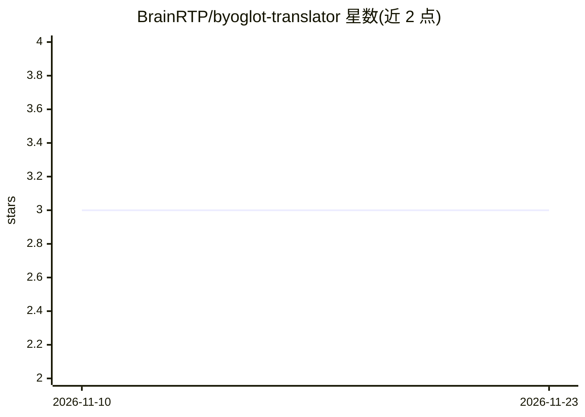

# BrainRTP/byoglot-translator

⭐ 3 · TypeScript · MIT · 推送 2026-11-19 · [GitHub](https://github.com/BrainRTP/byoglot-translator) · 个人维护

**复用你自有模型与提示词的浏览器页面/划词翻译扩展**

Manifest V3 的 Chrome/Firefox 扩展，按需翻译网页与选中文本，模型由用户自备：可连接本地 opencode 服务，或填 OpenAI 兼容 API 的 key（内置 DeepSeek、OpenRouter、OpenAI、Mistral、Ollama、LM Studio 预设及自定义 URL）。翻译指令（pre-prompt）由用户编写并保存为模板，可绑定到站点；页面翻译有 IndexedDB 缓存，划词卡片支持一次性与固定Feed两种模式。无自有账号与服务器，key 存于 storage.local，MIT 许可，Firefox 需从源码构建加载。

## 筛选速览

| 维度 | 判定 | 备注 |
|---|---|---|
| AI 角色 | `ai-native` | 本体是模型或模型工具 |
| 许可风险 | `permissive` | MIT |
| 部署形态 | `library` | 以包/库形式分发 |
| 模型依赖 | local-ok | 支持本地模型 |
| 硬件要求 | — | 无带数字的原话,不猜 |
| 安装摩擦 | `medium` | 含编译或系统依赖之一 |
| 成熟度 | — | 结构信号不足 |

## 能力要点

- 连接本地 opencode 或任意 OpenAI 兼容 API，模型与提示词由用户自备
- 自由格式 pre-prompt 模板，可绑定到具体站点域名规则
- 页面替换/对照两种翻译模式，含 IndexedDB 翻译缓存与 SPA 后续内容翻译
- 划词翻译卡片支持 One-shot 与固定 Feed 模式及独立翻译页

## 适用场景

- 复用已有的 DeepSeek/OpenRouter key 或 opencode 订阅来翻译网页
- 自定义术语处理规则（保留英文并加括号注释、解释学术词汇）
- 本地 Ollama/LM Studio 模型离线翻译，文本不出内网
- 为学术阅读定制带释义与词源的划词翻译模板

## 场景标签

 · 领域:浏览器工具/翻译

## 证据(README 行号)

> L7: A Chrome and Firefox extension (Manifest V3) that translates web pages and selected text with a model you bring. You
> L18: Most AI translators either lock you into their own subscription or ask for an API key per provider. If you already 
> L64: Use this when you have no opencode but have an API key. The extension calls the `chat/completions` and `models` end

## 星数曲线

2026-11-10 3 → 2026-11-23 3（+0）

---
*卡片 v1 · prompt 1.4 · 生成 2026-11-22 · 置信度 high · 依据 README sha `f147c7e79b70` · [字段定义](../../DATASET.md)*
