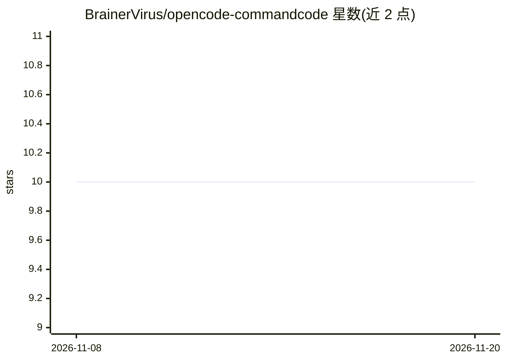

# BrainerVirus/opencode-commandcode

⭐ 10 · TypeScript · MIT · 推送 2026-11-19 · [GitHub](https://github.com/BrainerVirus/opencode-commandcode) · [官网](https://www.npmjs.com/package/@brainervirus/opencode-commandcode) · 个人维护

**为 OpenCode 接入 Command Code Provider API 的插件**

面向持有 Command Code Provider API 权限账号的 OpenCode 用户：插件内置 models.json 模型目录，由 CI 定期从 command-code npm 包提取并更新，无需本地 CLI。支持 V1/V2 两代 OpenCode 的注册方式，按模型声明选择 Messages/Chat Completions/Responses 路由，提供推理力度变体、免费模型名称标注、可选的零数据保留（ZDR）请求头，目录损坏时回退上次可用缓存。限制：$1 Go 计划无 Provider API 权限，目录中的模型不代表账号均可调用。

## 筛选速览

| 维度 | 判定 | 备注 |
|---|---|---|
| AI 角色 | `ai-ecosystem` | LLM/agent 周边工具 |
| 许可风险 | `permissive` | MIT |
| 部署形态 | `None` |  |
| 模型依赖 | — | README 未给出锁定关系 |
| 硬件要求 | — | 无带数字的原话,不猜 |
| 安装摩擦 | `low` | 无编译、无系统依赖或容器化 |
| 成熟度 | — | 结构信号不足 |

## 能力要点

- CI 自动维护内置 models.json 模型目录，无需本地 command-code CLI
- 按 supported_endpoints 元数据为每个模型选择 Messages/Chat Completions/Responses 路由
- 支持零数据保留（ZDR）请求头，经 CMD_ZDR=1 或配置文件开启
- 目录 degraded/broken 时回退上次可用缓存，空目录下仍注册认证

## 适用场景

- 在 OpenCode 中用单个 API key 调用 Claude、GPT、Gemini、DeepSeek 等多家模型
- 让 OpenCode 自动获得 Command Code 目录的最新模型与价格元数据
- 对数据留存有合规要求时为请求启用 ZDR 上游路由

## 场景标签

`模型网关` · 领域:Agent 开发

## 证据(README 行号)

> L7: Command Code API provider for opencode. Use Claude, GPT, Gemini, DeepSeek, Qwen, Kimi, GLM, MiniMax, Step, and other
> L22: - V1 and V2 use their native plugin and provider surfaces. V1 `server()` fills `provider.commandcode` and registers
> L69: On OpenCode V2 the plugin registers the `commandcode` provider, its models, the native OpenCode runtime, and its AP

## 星数曲线

2026-11-08 10 → 2026-11-20 10（+0）

---
*卡片 v1 · prompt 1.4 · 生成 2026-11-20 · 置信度 high · 依据 README sha `fe9c0ce79c89` · [字段定义](../../DATASET.md)*
