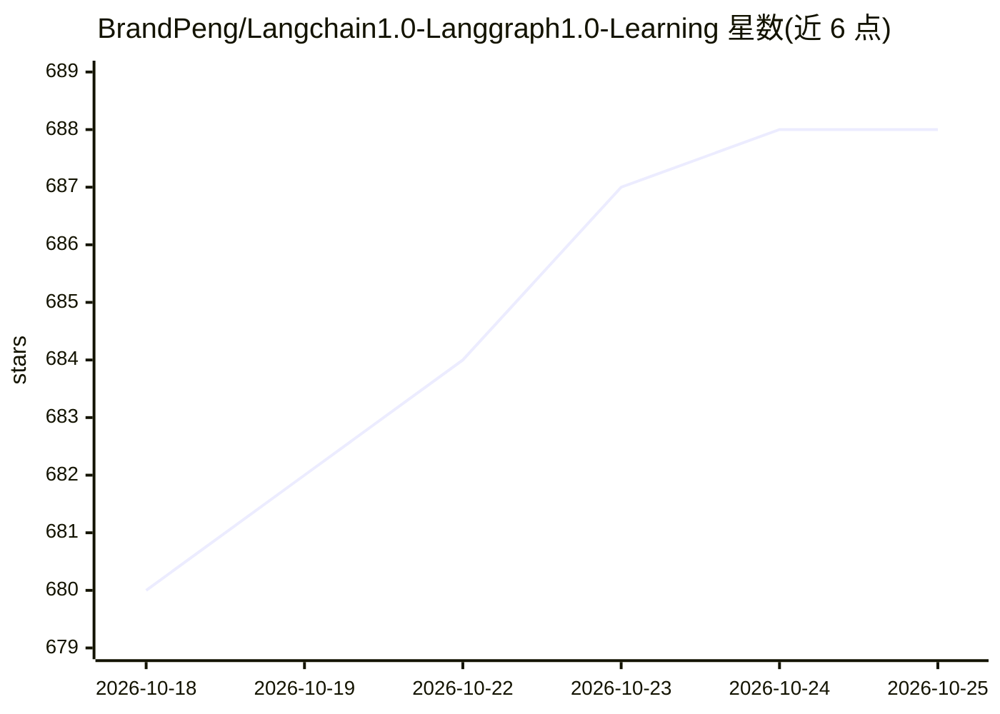

# BrandPeng/Langchain1.0-Langgraph1.0-Learning

⭐ 688 · Python · MIT · 推送 2026-10-07 · [GitHub](https://github.com/BrandPeng/Langchain1.0-Langgraph1.0-Learning) · 个人维护 · 中文 README

**LangChain 1.0 与 LangGraph 1.0 的中文学习教程仓库**

面向 Agent 开发学习者的实践教程仓库，按四阶段组织 22 个模块与 3 个综合项目（RAG 系统、智能客服、研究助手），内容覆盖 create_agent API、中间件、结构化输出、RAG 基础与进阶、LangGraph 状态图与多 Agent 协作等。示例代码依赖 Groq API key 运行，OpenAI、Pinecone、LangSmith 为可选项。通过 git clone 源码并安装依赖运行，要求 Python 3.10 及以上。

## 筛选速览

| 维度 | 判定 | 备注 |
|---|---|---|
| AI 角色 | `ai-knowledge` | 知识聚合/清单类 |
| 许可风险 | `permissive` | MIT |
| 部署形态 | `None` |  |
| 模型依赖 | — | README 未给出锁定关系 |
| 硬件要求 | — | 无带数字的原话,不猜 |
| 安装摩擦 | `low` | 无编译、无系统依赖或容器化 |
| 成熟度 | — | 结构信号不足 |

## 能力要点

- 四阶段渐进式学习路径：22 个模块 + 3 个综合项目
- 覆盖 create_agent、中间件、RAG、LangGraph 多 Agent 等主题
- 示例使用 Groq 免费 API 运行，附 API key 配置与常见问题说明

## 适用场景

- 系统学习 LangChain 1.0 / LangGraph 1.0 的 Agent 开发
- 按模块逐步练习 RAG、结构化输出与多 Agent 协作
- 参考综合项目搭建文档问答或智能客服系统

## 场景标签

`教程课程` · 领域:学习与行业

## 证据(README 行号)

> L3: > 这是一个系统学习 **LangChain 1.0** 和 **LangGraph 1.0** 的实践仓库，涵盖从基础概念到实战项目的完整学习路径。
> L57: 本仓库采用**四阶段渐进式学习**，共 22 个模块 + 3 个综合项目：

## 星数曲线

2026-10-18 680 → 2026-10-25 688（+8）

---
*卡片 v1 · prompt 1.4 · 生成 2026-10-21 · 置信度 high · 依据 README sha `037798585eb7` · [字段定义](../../DATASET.md)*
