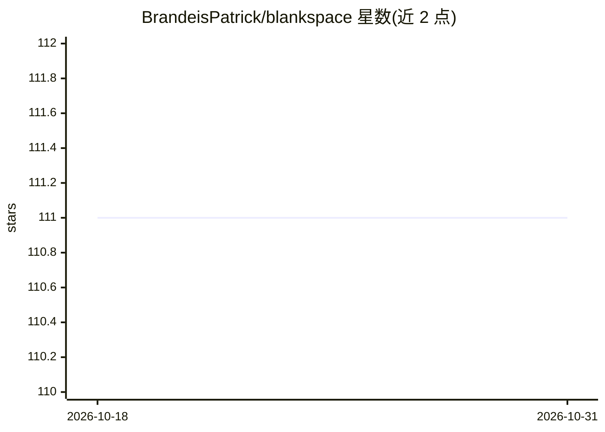

# BrandeisPatrick/blankspace

⭐ 111 · JavaScript · Apache-2.0 · 推送 2026-05-16 · [GitHub](https://github.com/BrandeisPatrick/blankspace) · [官网](https://www.blankspace.build/) · 个人维护

**浏览器中运行的开源自托管 AI 应用构建器**

开源 AI app builder，在浏览器中使用，支持自托管并针对移动端优化。核心是多 agent 编排层：Code Agent（Gemini 3 Flash/Pro）负责代码生成与调试，配备 read/write/edit/glob/grep 等工具；Chat Agent（GPT-5-mini）处理对话与网页搜索；Assistant Agent（GPT-5-mini）操作用户存储中的文件。前端为 React (Vite)，可通过 Vercel 部署或源码运行，需配置 OPENAI_API_KEY 与 GOOGLE_AI_API_KEY 环境变量。采用 Apache 2.0 许可。

## 筛选速览

| 维度 | 判定 | 备注 |
|---|---|---|
| AI 角色 | `ai-native` | 本体是模型或模型工具 |
| 许可风险 | `permissive` | Apache-2.0 |
| 部署形态 | `library` | 以包/库形式分发 |
| 模型依赖 | — | README 未给出锁定关系 |
| 硬件要求 | — | 无带数字的原话,不猜 |
| 安装摩擦 | `low` | 无编译、无系统依赖或容器化 |
| 成熟度 | — | 结构信号不足 |

## 能力要点

- 浏览器内运行、支持自托管的 AI 应用构建器
- 多 agent 编排：Code/Chat/Assistant 三类 agent 分工
- Code Agent 配备 read/write/edit/glob/grep/validate 文件工具
- React (Vite) 前端，支持 Vercel 部署

## 适用场景

- 在浏览器中通过对话生成和修改 Web 应用代码
- 自托管一个面向移动端的 AI 应用构建服务
- 让 agent 读写用户存储中的文件完成开发任务

## 场景标签

`多智能体` `编码 Agent` · 领域:Agent 开发

## 证据(README 行号)

> L3:  AI coding agent in your browser
> L19: Open-source AI app builder. Fast, simple, self-hostable (optimized for mobile).

## 星数曲线

2026-10-18 111 → 2026-10-31 111（+0）

---
*卡片 v1 · prompt 1.4 · 生成 2026-10-23 · 置信度 high · 依据 README sha `03486d154894` · [字段定义](../../DATASET.md)*
