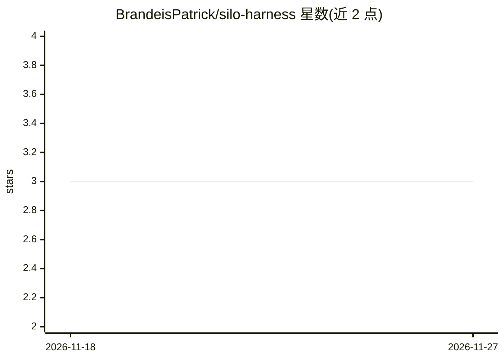

# BrandeisPatrick/silo-harness

⭐ 3 · JavaScript · MIT · 推送 2026-11-22 · [GitHub](https://github.com/BrandeisPatrick/silo-harness) · [官网](https://brandeispatrick.github.io/silo-harness/) · 个人维护

**开源 Claude Code 风格 macOS agent 客户端，支持本地与托管模型**

基于 Electron + TypeScript 的 Mac 应用，提供类似 Claude Code 的 agent 工作流：权限模式、审批卡片、计划模式、回退、任务列表、@文件提及与 #记忆。可接入托管模型（OpenRouter 等）或本地模型（Ollama）；Dreaming 机制每日读取近期会话，建议可采纳的技能、记忆与 mods；mods 为沙盒 web 文件夹，可自定义界面面板。提供会话并行、子会话合并、内置可登录浏览器、手机远程控制。安装包未公证，首次打开需在系统设置中放行。

## 筛选速览

| 维度 | 判定 | 备注 |
|---|---|---|
| AI 角色 | `ai-ecosystem` | LLM/agent 周边工具 |
| 许可风险 | `permissive` | MIT |
| 部署形态 | `library` | 以包/库形式分发 |
| 模型依赖 | local-ok | 支持本地模型 |
| 硬件要求 | — | 无带数字的原话,不猜 |
| 安装摩擦 | `low` | 无编译、无系统依赖或容器化 |
| 成熟度 | — | 结构信号不足 |

## 能力要点

- 支持本地（Ollama）与托管（OpenRouter 等 OpenAI 兼容服务）多模型运行
- Dreaming 从历史会话生成技能、记忆与 mods 建议，附证据与可回退
- MCP 服务器、SKILL.md 技能、AGENTS.md/CLAUDE.md 等标准扩展格式
- mods 协议允许 agent 按需构建面板与界面样式

## 适用场景

- 在 Mac 上用本地模型运行编码 agent，数据不出本机
- 让 agent 添加功能、改 API 并运行测试
- 将重复需求沉淀为技能与 mods 复用
- 多会话并行处理不同任务并从手机跟进审批

## 场景标签

`编码 Agent` `AI 助手` · 领域:编码与开发

## 证据(README 行号)

> L2:  An open-source, Claude Code–style Mac app that runs any model, local or hosted.
> L37: - **The Claude Code workflow.** Permission modes, approval cards, plan mode, rewind, a task list in the chat, queue
> L44: - **Standard extensions.** MCP servers (`.mcp.json`), skills (`SKILL.md`), project instructions (`AGENTS.md` / `CLA

## 星数曲线

2026-11-18 3 → 2026-11-27 3（+0）

---
*卡片 v1 · prompt 1.4 · 生成 2026-11-22 · 置信度 high · 依据 README sha `4916a271303b` · [字段定义](../../DATASET.md)*
