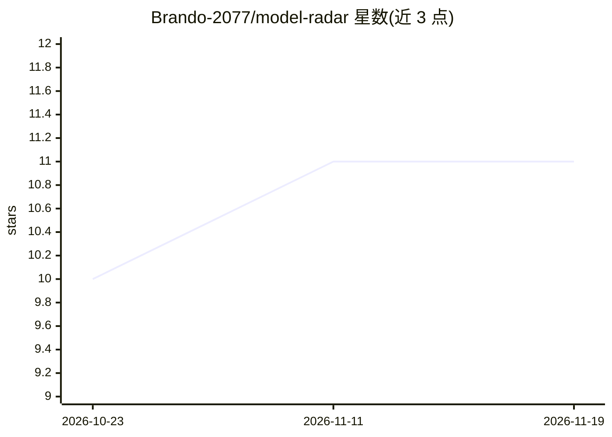

# Brando-2077/model-radar

⭐ 11 · HTML · MIT · 推送 2026-11-17 · [GitHub](https://github.com/Brando-2077/model-radar) · [官网](https://brando-2077.github.io/model-radar/) · 个人维护 · 中文 README

**按任务场景给 LLM 生成 8 维能力雷达图的选型工具**

把公开榜单（Artificial Analysis、LiveBench、LMArena、SuperCLUE 等）折算成基准族内位次分，聚合为推理、代码、Agent、长文本等 8 个能力维度，并提供 5 套场景权重（自媒体运营、Agent 工作流、代码开发、RAG、日常综合）供按任务选模型。核心机制包括同基准族内排名、小族降权、缺数据维度留白让位而非按 0 计入，每条分数可点开查看来源 URL 与数据日期。交付物为内联数据的单文件 HTML，离线可用；截至快照含 1030 条证据、38 个模型、69 个基准族。

## 筛选速览

| 维度 | 判定 | 备注 |
|---|---|---|
| AI 角色 | `ai-knowledge` | 知识聚合/清单类 |
| 许可风险 | `permissive` | MIT |
| 部署形态 | `library` | 以包/库形式分发 |
| 模型依赖 | — | README 未给出锁定关系 |
| 硬件要求 | — | 无带数字的原话,不猜 |
| 安装摩擦 | `low` | 无编译、无系统依赖或容器化 |
| 成熟度 | — | 结构信号不足 |

## 能力要点

- 8 维能力雷达 + 5 套场景权重，按任务加权选模型
- 基准族内位次分算法，避免跨榜单直接平均
- 缺失数据留白处理，不做 0 分填充
- 单文件 HTML 交付，双击即开、离线可用、零运行时依赖

## 适用场景

- 为自己的 Agent/代码/RAG 场景挑选合适的模型
- 查看某模型在 8 个能力维度上的公开基准证据与出处
- 贡献或纠错公开榜单数据，维护可复核的选型账本

## 场景标签

`模型评测` · 领域:评测与运维

## 证据(README 行号)

> L5: 把公开榜单折算成 8 个能力维度，按任务场景加权；没有证据的维度留白，不拿 0 分代替。
> L35: - **5 套场景权重**：自媒体内容运营、Agent 与工作流、代码开发、RAG 知识问答、日常综合。
> L39: - **单文件交付**：`model-radar.html` 自带数据与交互，双击即开、离线可用、零运行时依赖。

## 星数曲线

2026-10-23 10 → 2026-11-19 11（+1）

---
*卡片 v1 · prompt 1.4 · 生成 2026-11-19 · 置信度 mid · 依据 README sha `878ed4eaa99e` · [字段定义](../../DATASET.md)*
