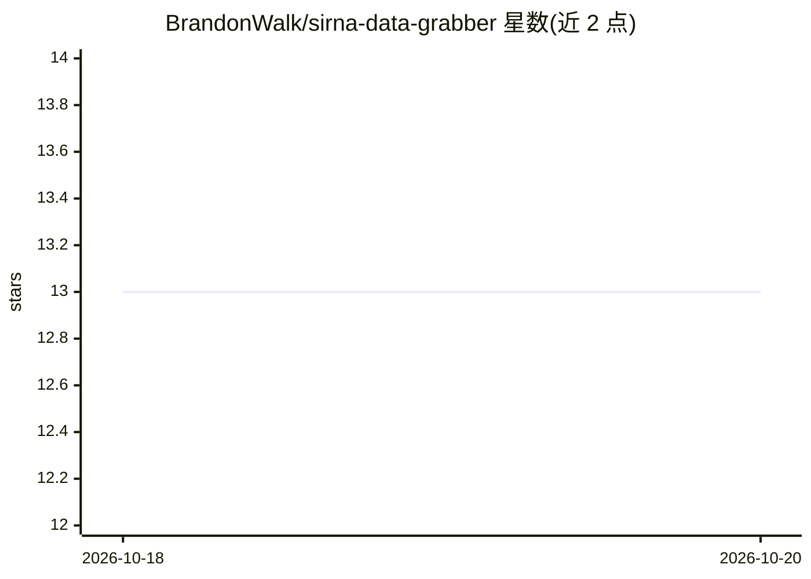

# BrandonWalk/sirna-data-grabber

⭐ 13 · Python · NOASSERTION · 推送 2026-09-29 · [GitHub](https://github.com/BrandonWalk/sirna-data-grabber) · [官网](https://pypi.org/project/sirna-data-grabber/) · 个人维护

**18,467 条 siRNA 敲低效力数据集及配套 Python 加载包**

独立的 siRNA 敲低效力数据集聚合仓库：收录来自 10 个来源（siRNAEfficacyDB、CMsiRNAdb、Martin 2007 等）共 18,467 条记录、覆盖 243 个基因，每条记录附来源、许可证、转录本长度与细胞系信息。提供 sirna_data Python 包通过 load_records() 加载，各数据源可用 include_<data-source> 标志单独开关；因 PyPI 无法分发多数非商业数据，附带 sirna-data-fetch 命令从原始来源重新拉取。多数源采用 CC BY-NC 系列许可。

## 筛选速览

| 维度 | 判定 | 备注 |
|---|---|---|
| AI 角色 | `ai-knowledge` | 知识聚合/清单类 |
| 许可风险 | `none` | NOASSERTION |
| 部署形态 | `library` | 以包/库形式分发 |
| 模型依赖 | — | README 未给出锁定关系 |
| 硬件要求 | — | 无带数字的原话,不猜 |
| 安装摩擦 | `low` | 无编译、无系统依赖或容器化 |
| 成熟度 | — | 结构信号不足 |

## 动量与使用信号

- 安装:github 包 `release-assets` 月下载无数据

## 能力要点

- 18,467 条 siRNA 记录、243 个基因，来自 10 个来源
- 每个数据源可通过独立开关标志包含或排除
- 附 sirna-data-fetch 命令从原始来源重新拉取数据
- 逐源记录许可证（多为 CC BY-NC 系列）与验证文档

## 适用场景

- 训练或评测 siRNA 敲低效力预测模型时获取数据
- 按基因、细胞系筛选 siRNA 实验记录
- 以依赖方式引用数据集避免手动复制数据与加载代码

## 场景标签

 · 领域:生物信息学/数据集

## 证据(README 行号)

> L8: A standalone siRNA knockdown-efficacy dataset: the raw data files, full
> L16: Currently: 18,467 siRNA records across 243 genes (`load_records()`

## 星数曲线

2026-10-18 13 → 2026-10-20 13（+0）

---
*卡片 v1 · prompt 1.4 · 生成 2026-10-18 · 置信度 high · 依据 README sha `697c2dcc406e` · [字段定义](../../DATASET.md)*
