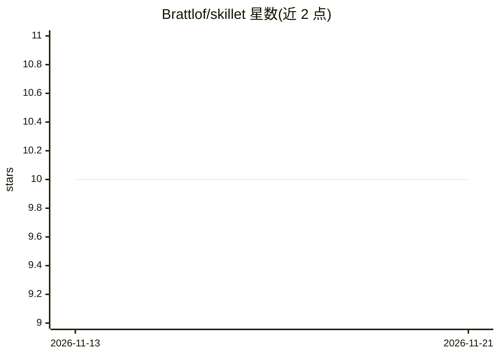

# Brattlof/skillet

⭐ 10 · Go · MIT · 推送 2026-11-20 · [GitHub](https://github.com/Brattlof/skillet) · 个人维护

**为 Claude Code 等 AI 编码工具安装 MCP 服务器与技能的包管理器**

零依赖的 Go 单二进制包管理器，从内置精选注册表（370+ 条目）搜索并安装 MCP 服务器、Agent Skills（SKILL.md 格式）及 Claude Code 的斜杠命令、钩子、子代理与输出风格。安装目标覆盖 Claude Code、Cursor、Codex、Gemini CLI、Copilot 与 Cline；支持版本锁定（skillet.lock）与精确还原、从 skills.sh 搜索社区技能并展示安全审计、离线模式与自定义注册表地址。

## 筛选速览

| 维度 | 判定 | 备注 |
|---|---|---|
| AI 角色 | `ai-ecosystem` | LLM/agent 周边工具 |
| 许可风险 | `permissive` | MIT |
| 部署形态 | `library` | 以包/库形式分发 |
| 模型依赖 | — | README 未给出锁定关系 |
| 硬件要求 | — | 无带数字的原话,不猜 |
| 安装摩擦 | `low` | 无编译、无系统依赖或容器化 |
| 成熟度 | — | 结构信号不足 |

## 能力要点

- 370+ 条目的精选验证注册表，嵌入式分发，无后端无账号
- 单静态 Go 二进制，不依赖 Node/npm，支持离线缓存与 ETag 校验
- skillet.lock 记录提交与校验和，install 可精确还原，--frozen 适用于 CI
- 社区技能接入 skills.sh 审计结果，默认拦截审计失败的安装

## 适用场景

- 一条命令为 Claude Code 或 Cursor 安装并管理 MCP 服务器
- 为多个 AI 编码工具统一安装跨工具可用的 Agent Skills
- 在 CI 中用锁定文件精确还原团队的技能与命令配置

## 场景标签

 · 领域:AI 开发者工具/agent 生态管理

## 证据(README 行号)

> L5: **A tiny, zero-dependency package manager for MCP servers, Agent Skills, and Claude Code commands, hooks, subagents,
> L17: Claude Code, Cursor, OpenAI Codex, Gemini CLI, Copilot, and Cline - from a curated, verified
> L18: registry of 370+ entries. One static Go binary, no Node or npm.

## 星数曲线

2026-11-13 10 → 2026-11-21 10（+0）

---
*卡片 v1 · prompt 1.4 · 生成 2026-11-20 · 置信度 high · 依据 README sha `afef98114179` · [字段定义](../../DATASET.md)*
