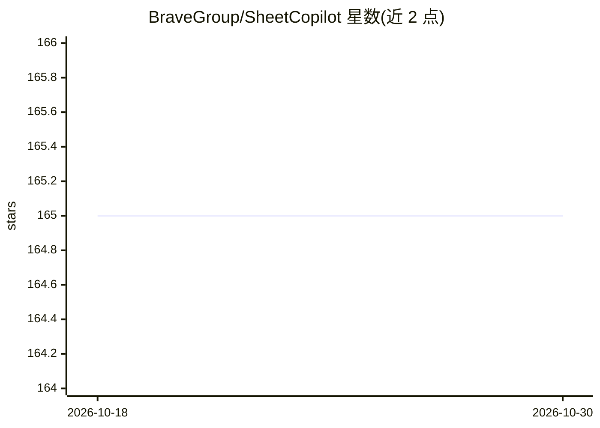

# BraveGroup/SheetCopilot

⭐ 165 · Python · GPL-3.0 · 推送 2026-06-25 · [GitHub](https://github.com/BraveGroup/SheetCopilot) · [官网](https://sheetcopilot.github.io/) · 组织维护

**用 LLM 按自然语言指令操控 Excel/Google Sheets 的闭环 agent**

研究项目仓库，发布 SheetCopilot agent 与配套评测环境：agent 通过状态机（4 状态）进行 CoT 规划，观察表格状态并根据外部动作文档与错误反馈修正方案，调用 44 个基于 pywin32 实现的原子操作（录入、格式化、图表、透视表等）操控 Excel。需 Windows + Python 3.10 + Conda，经现代 OpenAI SDK 接入任意 OpenAI 兼容服务；同时发布含 28 个工作簿、221 个任务的评测数据集，可评估任意表格 agent。另提供 Google Sheets 版本与交互模式；注意其执行的操作在 Excel 中无法用 Undo 撤销。

## 筛选速览

| 维度 | 判定 | 备注 |
|---|---|---|
| AI 角色 | `ai-native` | 本体是模型或模型工具 |
| 许可风险 | `viral` | GPL-3.0 |
| 部署形态 | `library` | 以包/库形式分发 |
| 模型依赖 | local-ok | 支持本地模型 |
| 硬件要求 | — | 无带数字的原话,不猜 |
| 安装摩擦 | `low` | 无编译、无系统依赖或容器化 |
| 成熟度 | — | 结构信号不足 |

## 能力要点

- 状态机闭环规划：观察表格状态并根据错误反馈修正方案
- 44 个原子操作覆盖录入、格式化、图表、透视表
- 221 任务 / 28 工作簿评测数据集，可用于评估任意表格 agent
- 经 OpenAI 兼容接口接入自有模型（vLLM/TGI/Ollama 等）

## 适用场景

- 用自然语言指令让 agent 自动完成 Excel 表格任务
- 在 Google Sheets 中通过对话自动化表格操作
- 用 221 任务数据集评测表格 agent（RL/LLM/规则）
- 复现论文实验或对比不同 LLM 的表格操控能力

## 场景标签

`GUI 自动化` `模型评测` · 领域:效率与自动化

## 证据(README 行号)

> L22: SheetCopilot is an assistant agent that manipulates spreadsheets by following user commands. It breaks new ground i
> L33: SheetCopilot employs a novel way of directing Large Language Models (LLMs) to manipulate spreadsheets like a human 
> L67: This dataset can be used to evaluate any spreadsheet agent including RL, LLM-based, or rule-based methods.

## 星数曲线

2026-10-18 165 → 2026-10-30 165（+0）

---
*卡片 v1 · prompt 1.4 · 生成 2026-10-22 · 置信度 high · 依据 README sha `6b5c9f5b7d49` · [字段定义](../../DATASET.md)*
