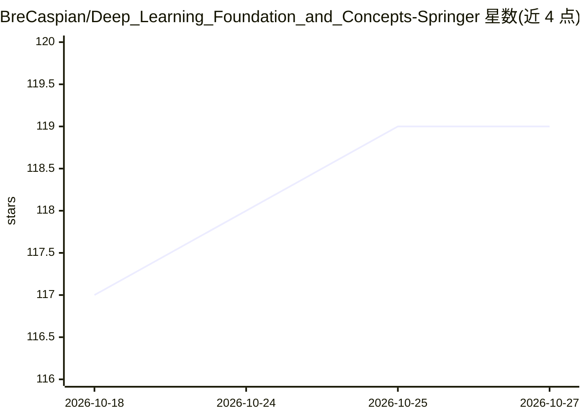

# BreCaspian/Deep_Learning_Foundation_and_Concepts-Springer

⭐ 119 · Jupyter Notebook · MIT · 推送 2026-09-27 · [GitHub](https://github.com/BreCaspian/Deep_Learning_Foundation_and_Concepts-Springer) · [官网](https://www.bishopbook.com) · 个人维护 · 中文 README

**深度学习教材《Deep Learning: Foundations and Concepts》配套资源仓库**

收录 Bishop 与 Hugh Bishop 所著、Springer 2023/2024 出版教材《深度学习：基础与概念》的补充资源：书籍 PDF/PNG 版本、代码示例与练习 Jupyter 笔记本（含手写数字识别、PyTorch 入门、UNet 架构等）、MNIST 数据集、书中图表，以及覆盖概率论、Transformer、变分自编码器等主题的练习数学推导解答。面向机器学习初学者、学术研究人员与学生、自学者。仓库还声明习题解答已由人民邮电出版社出版为《深度学习习题详解》，原创整理材料采用 CC BY-NC-SA 4.0 许可，原书版权归 Springer Nature。

## 筛选速览

| 维度 | 判定 | 备注 |
|---|---|---|
| AI 角色 | `ai-knowledge` | 知识聚合/清单类 |
| 许可风险 | `permissive` | MIT |
| 部署形态 | `None` |  |
| 模型依赖 | — | README 未给出锁定关系 |
| 硬件要求 | — | 无带数字的原话,不猜 |
| 安装摩擦 | `low` | 无编译、无系统依赖或容器化 |
| 成熟度 | — | 结构信号不足 |

## 能力要点

- 书籍 PDF/PNG 版本与全书图表
- 代码练习笔记本（含 PyTorch 入门、UNet 等）与 MNIST 数据集
- 全部练习题的数学推导解答（Solutions/ 目录）
- 中文版及《深度学习习题详解》出版信息与引用格式（BibTeX）

## 适用场景

- 学习深度学习教材时配套练习与查阅解答
- 用 Code/ 与 Data/ 目录的笔记本和数据集做实践
- 研究中引用原书时获取标准 BibTeX 条目

## 场景标签

`教程课程` · 领域:学习与行业

## 证据(README 行号)

> L5: 本仓库包含《深度学习：基础与概念》(Deep Learning: Foundations and Concepts) 一书的补充资源、练习材料和解决方案。该书由 Christopher M. Bishop 和 Hugh Bishop
> L53: - **Code/** - 代码示例和练习笔记本
> L61: - **Solutions/** - 书籍练习的相关数学推导解答 ⭐已更新完成所有练习题解答⭐

## 星数曲线

2026-10-18 117 → 2026-10-27 119（+2）

---
*卡片 v1 · prompt 1.4 · 生成 2026-10-23 · 置信度 high · 依据 README sha `edf652ecb450` · [字段定义](../../DATASET.md)*
