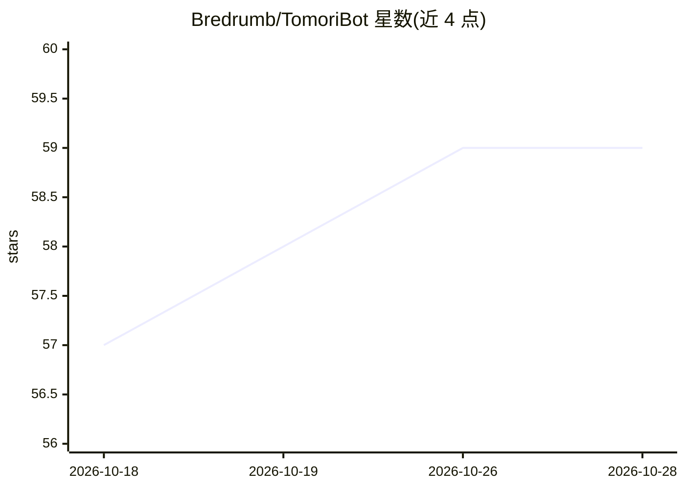

# Bredrumb/TomoriBot

⭐ 60 · TypeScript · AGPL-3.0 · 推送 2026-10-28 · [GitHub](https://github.com/Bredrumb/TomoriBot) · [官网](https://docs.tomoribot.app) · 个人维护

**可自托管的 Discord 个人 AI 助手/角色扮演机器人**

基于 Discord.js 与 TypeScript、以 Bun 运行的开源 Discord 机器人，功能包括长期记忆（RAG 与短期记忆）、多人格管理、Web/MCP 工具调用、多模态输入输出（图像/音频/视频生成，附 ComfyUI 工作流与本地语音服务器）、200+ 原生斜杠命令、SillyTavern 预设与角色卡导入。支持 API 密钥、自定义代理或自托管本地模型。可使用官方托管实例，或经 Bun 安装向导/Docker Compose 自建；本地运行需 Bun 与 PostgreSQL（或用 Docker 提供数据库）。AGPL-3.0 许可。

## 筛选速览

| 维度 | 判定 | 备注 |
|---|---|---|
| AI 角色 | `ai-native` | 本体是模型或模型工具 |
| 许可风险 | `viral` | AGPL-3.0 |
| 部署形态 | `self-host` | docker 或自建部署 |
| 模型依赖 | — | README 未给出锁定关系 |
| 硬件要求 | — | 无带数字的原话,不猜 |
| 安装摩擦 | `low` | 无编译、无系统依赖或容器化 |
| 成熟度 | `idea` | |

## 能力要点

- 长期记忆（RAG/STM）与多人格系统，人格可导入导出
- 多模态处理与生成，支持本地模型端点或 API 密钥，附 ComfyUI 工作流
- 200+ 原生斜杠命令管理人格、提示词、模型参数与 MCP 工具服务器
- 提供 Bun 安装向导与 Docker Compose 两种自托管路径

## 适用场景

- 在 Discord 服务器或私信中运行带记忆的个人 AI 助手
- 用多人格系统进行角色扮演，导入 SillyTavern 角色卡
- 自托管实例以完全掌控数据与 API 密钥

## 场景标签

`AI 助手` `聊天机器人` `Agent 记忆` · 领域:Agent 开发

## 证据(README 行号)

> L12: A self-hosted and customizable personal AI assistant/role-playing system for Discord with memory, multiple personas
> L37: TomoriBot is a free and open-source self-hosted personal AI assistant and role-playing system for Discord, inspired

## 星数曲线

2026-10-18 57 → 2026-10-28 59（+2）

---
*卡片 v1 · prompt 1.4 · 生成 2026-10-24 · 置信度 high · 依据 README sha `34bcbaca84a2` · [字段定义](../../DATASET.md)*
