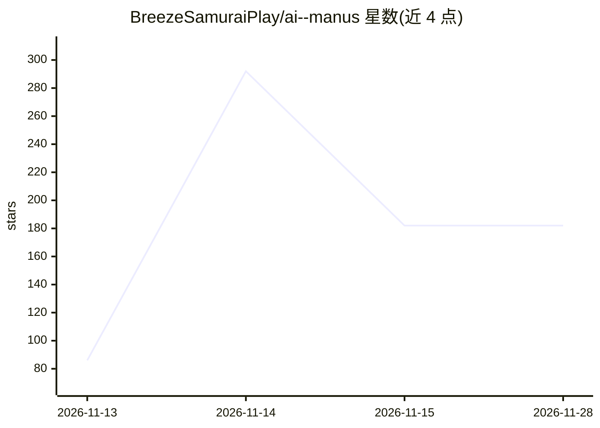

# BreezeSamuraiPlay/ai--manus

⭐ 182 · Apache-2.0 · 推送 2026-11-15 · [GitHub](https://github.com/BreezeSamuraiPlay/ai--manus) · 个人维护

**面向日常小任务的自主 AI Agent：代跑代码与控制浏览器**

Manus 是一个自主 AI 代理系统，按 README 描述可在沙箱中运行代码并控制浏览器，替用户执行多步骤任务：编写执行脚本、打开网页、填写表单、收集信息，面向学习、家庭项目与轻量办公场景。README 说明任务可在脚本与浏览器之间衔接，并给出最低 4GB 内存等兼容性要求与上手步骤。但 README 未提供任何安装命令、源码结构或 API 接入方式，仅含下载引导与促销码，技术细节无法从文档验证。

## 筛选速览

| 维度 | 判定 | 备注 |
|---|---|---|
| AI 角色 | `ai-native` | 本体是模型或模型工具 |
| 许可风险 | `permissive` | Apache-2.0 |
| 部署形态 | `None` |  |
| 模型依赖 | — | README 未给出锁定关系 |
| 硬件要求 | — | 无带数字的原话,不猜 |
| 安装摩擦 | `low` | 无编译、无系统依赖或容器化 |
| 成熟度 | — | 结构信号不足 |

## 能力要点

- 自主执行代码与浏览器操作的多步骤任务
- 脚本与浏览器动作可在同一任务流中衔接
- 面向家庭、学习与小规模办公任务设计
- README 列出最低 4GB 内存等兼容性要求

## 适用场景

- 让代理替我查网页、填表单、收集资料
- 自动跑小脚本处理重复性日常任务
- 远程技术支持中快速检查系统页面

## 场景标签

`浏览器自动化` `AI 助手` · 领域:效率与自动化

## 证据(README 行号)

> L10: - **Autonomous Code Execution:** Manus AI agent runs code on its own to complete tasks, so you can focus on decisio
> L18: Manus is an autonomous AI agent designed to run code and control a browser on your behalf. Instead of acting like a

## 星数曲线

2026-11-13 86 → 2026-11-28 182（+96）

---
*卡片 v1 · prompt 1.4 · 生成 2026-11-17 · 置信度 low · 依据 README sha `0f78ee3a5dd2` · [字段定义](../../DATASET.md)*
