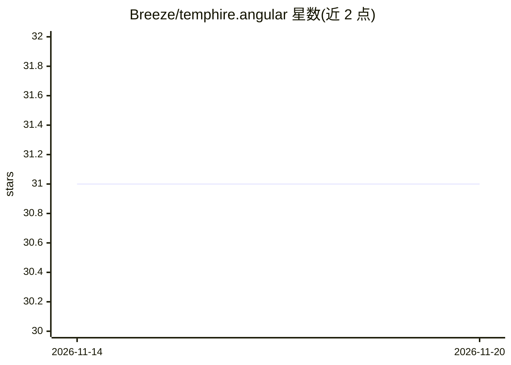

# Breeze/temphire.angular

⭐ 31 · C# · 推送 2026-11-19 · [GitHub](https://github.com/Breeze/temphire.angular) · 组织维护

**Angular/.NET 业务应用参考实现：数据编辑与 AI 数据问答助手**

基于 Angular 22、Breeze 3 与 .NET 10/EF Core 的数据驱动 line-of-business 参考应用：主从工作区、沙箱化编辑与保存/取消、缓存查找集、单一模型驱动的客户端与服务端验证、认证与由服务端模型生成的实体类，并支持多租户（查询与保存限定在本公司数据内）。AI 部分为 Quinn 聊天助手：通过同一 .NET 服务器内的 MCP server 以自然语言回答公司人员配置数据问题，可用本地 Ollama 模型或 Claude。仓库同时作为 Silverlight/WPF 旧应用的现代化迁移示例。运行需 .NET 10 SDK、Node 26 与 SQL Server LocalDB。

## 筛选速览

| 维度 | 判定 | 备注 |
|---|---|---|
| AI 角色 | `ai-enhanced` | 去掉 AI 部分产品仍成立 |
| 许可风险 | `none` | — |
| 部署形态 | `library` | 以包/库形式分发 |
| 模型依赖 | local-ok | 支持本地模型 |
| 硬件要求 | — | 无带数字的原话,不猜 |
| 安装摩擦 | `medium` | 含编译或系统依赖之一 |
| 成熟度 | — | 结构信号不足 |

## 能力要点

- 沙箱化编辑、模型驱动验证与生成的 TypeScript 实体类（breeze-gen-entities）
- 多租户：查询与保存按用户所属公司隔离
- Quinn AI 助手经 MCP server 回答人员配置数据，支持 Ollama 本地模型或 Claude
- 从 Silverlight/WPF Punch 框架迁移的现代化示例，逐文件标注来源

## 适用场景

- 学习 Breeze 3 + Angular + EF Core 的业务应用架构与实体生成流程
- 参考如何在一个已登录的 .NET 业务应用中集成 MCP 与聊天助手
- 对照 Silverlight/WPF 旧版阅读遗留系统现代化迁移的做法

## 场景标签

`AI 助手` `数据分析` · 领域:效率与自动化

## 证据(README 行号)

> L33: Multi-tenancy). And it has **Quinn**, an AI assistant in a chat pane who answers
> L34: questions about the company's staffing data in plain language, through an MCP server in the same
> L35: .NET server, with a local Ollama model or Claude (see Quinn, the assistant).

## 星数曲线

2026-11-14 31 → 2026-11-20 31（+0）

---
*卡片 v1 · prompt 1.4 · 生成 2026-11-18 · 置信度 high · 依据 README sha `b508ffb4367d` · [字段定义](../../DATASET.md)*
