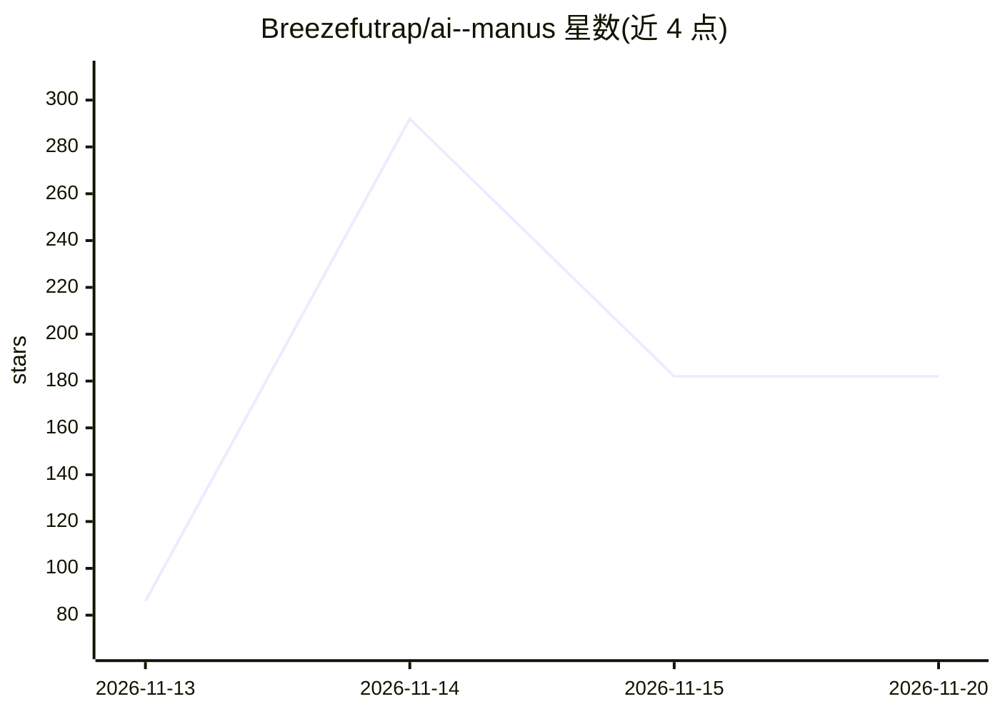

# Breezefutrap/ai--manus

⭐ 182 · Apache-2.0 · 推送 2026-11-15 · [GitHub](https://github.com/Breezefutrap/ai--manus) · 个人维护

**面向个人用户的自主 AI Agent：代为执行代码与浏览器操作**

README 描述的 Manus 是一个自主 AI Agent，宣称可代替用户编写并执行脚本、控制浏览器（导航网页、填写表单、收集信息），并执行多步骤日常任务，定位为家庭、学习与轻办公场景的私人助手。内容包含功能宣传、硬件兼容表（最低 4GB 内存/双核 CPU）与上手步骤，但未提供任何安装命令、代码位置、依赖说明或 API 接入方式；'Download Manus' 与促销码 'PROMO2026' 指向外部下载，仓库内无可见的技术实现信息。

## 筛选速览

| 维度 | 判定 | 备注 |
|---|---|---|
| AI 角色 | `ai-native` | 本体是模型或模型工具 |
| 许可风险 | `permissive` | Apache-2.0 |
| 部署形态 | `None` |  |
| 模型依赖 | — | README 未给出锁定关系 |
| 硬件要求 | — | 无带数字的原话,不猜 |
| 安装摩擦 | `low` | 无编译、无系统依赖或容器化 |
| 成熟度 | — | 结构信号不足 |

## 能力要点

- 宣称支持自主代码执行与浏览器控制
- 宣称支持多步骤任务与跨会话模式记忆
- 面向家庭/学习/轻办公的小规模场景

## 适用场景

- 让 Agent 代为执行重复性的脚本与网页操作
- 学习与调研中自动收集参考资料、整理笔记
- 轻办公场景下从多个网页汇总信息

## 场景标签

`浏览器自动化` `AI 助手` · 领域:效率与自动化

## 证据(README 行号)

> L10: - **Autonomous Code Execution:** Manus AI agent runs code on its own to complete tasks, so you can focus on decisio
> L18: Manus is an autonomous AI agent designed to run code and control a browser on your behalf. Instead of acting like a

## 星数曲线

2026-11-13 86 → 2026-11-20 182（+96）

---
*卡片 v1 · prompt 1.4 · 生成 2026-11-17 · 置信度 low · 依据 README sha `0f78ee3a5dd2` · [字段定义](../../DATASET.md)*
