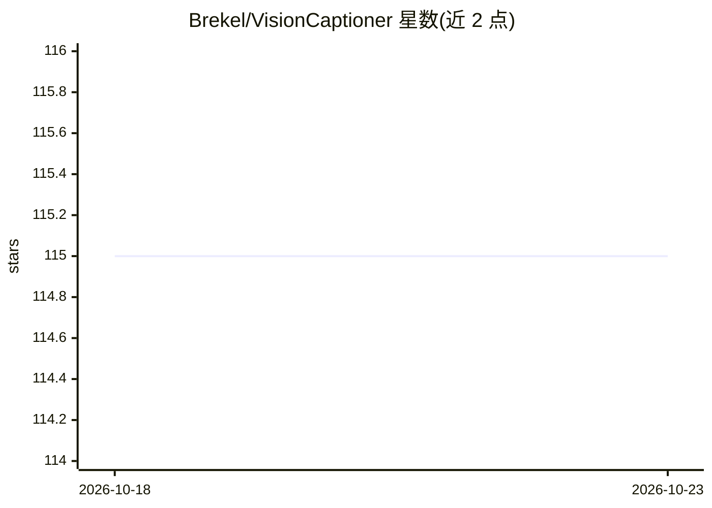

# Brekel/VisionCaptioner

⭐ 115 · Python · Apache-2.0 · 推送 2026-09-18 · [GitHub](https://github.com/Brekel/VisionCaptioner) · [官网](https://brekel.com) · 个人维护

**本地桌面应用：批量为图像/视频数据集生成字幕与分割掩码**

面向训练自定义模型（LoRA、SDXL、Flux 等）的研究者与爱好者的本地桌面工具：调用 Qwen-VL 与 Google Gemma 4 系列视觉语言模型批量生成图像与视频（多帧抽取）字幕，支持 Trigger Word 注入、跳过已有字幕、查找替换、系统提示词预设、分辨率与量化设置；另提供基于 SAM3 的可提示掩码生成与可视化编辑、视频抽帧、模糊/人脸等质量分析与加权评分，兼容 OneTrainer。含 CLI。需 Python 3.10+，支持 NVIDIA CUDA / AMD ROCm / Apple Silicon MPS，从源码克隆运行，模型可经内置下载器或 HuggingFace 手动安装。

## 筛选速览

| 维度 | 判定 | 备注 |
|---|---|---|
| AI 角色 | `ai-native` | 本体是模型或模型工具 |
| 许可风险 | `permissive` | Apache-2.0 |
| 部署形态 | `library` | 以包/库形式分发 |
| 模型依赖 | local-ok | 支持本地模型 |
| 硬件要求 | — | 无带数字的原话,不猜 |
| 安装摩擦 | `medium` | 含编译或系统依赖之一 |
| 成熟度 | — | 结构信号不足 |

## 能力要点

- Qwen2.5-VL/Qwen3-VL/Gemma 4（含 GGUF）批量生成图像与视频字幕
- SAM3 可提示掩码生成与可视化编辑，掩码可存文件或嵌入图像
- 质量分析：模糊/分辨率/人脸检测/缺失掩码与加权评分排序
- Trigger Word 注入、跳过已有字幕等面向训练数据集的功能

## 适用场景

- 为 LoRA/微调训练集批量生成带 Trigger Word 的字幕
- 用 SAM3 为训练图像制作掩码并检查掩码完整性
- 审查、编辑与筛选图像数据集质量

## 场景标签

`多模态` `人脸识别` `图像视频处理` · 领域:感知与多模态

## 证据(README 行号)

> L3: **VisionCaptioner** is a local desktop application designed to automate the creation of detailed captions for image 
> L12: * **Caption generation** Automatically generate captions using Qwen-VL or Google Gemma 4 models.

## 星数曲线

2026-10-18 115 → 2026-10-23 115（+0）

---
*卡片 v1 · prompt 1.4 · 生成 2026-10-23 · 置信度 mid · 依据 README sha `6d2f2fa30587` · [字段定义](../../DATASET.md)*
