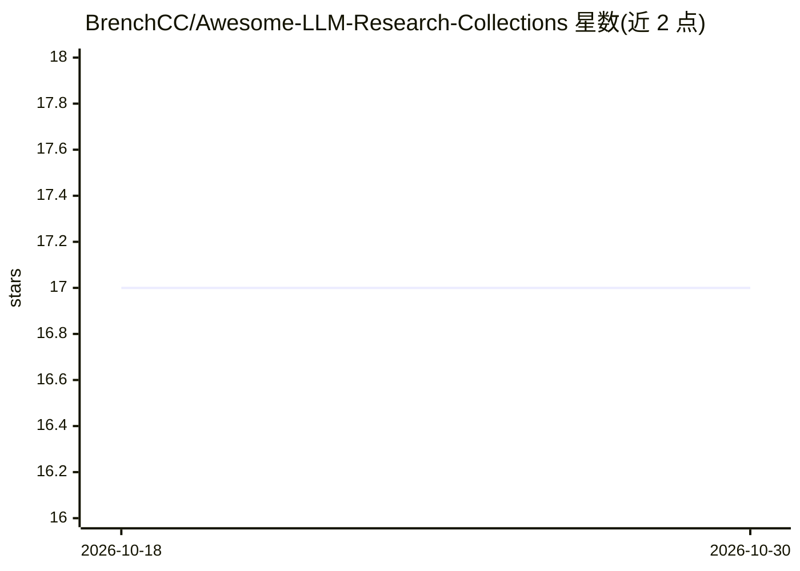

# BrenchCC/Awesome-LLM-Research-Collections

⭐ 17 · Python · MIT · 推送 2026-10-29 · [GitHub](https://github.com/BrenchCC/Awesome-LLM-Research-Collections) · [官网](https://brenchcc.github.io/Awesome-LLM-Research-Collections/) · 个人维护 · 中文 README

**LLM 研究论文与仓库的个人策展清单**

个人维护的 LLM/VLM 论文与仓库聚合清单，按 Attention 架构、基础模型等类别组织条目，每条含论文描述及 Paper/Code/Hugging Face 链接。内容覆盖稀疏注意力、RoPE、MQA 等注意力机制研究与 DeepSeek、Kimi、Qwen、MiniMax、GLM 等系列模型技术报告。README 提供中英双语说明，并推荐一个用于加速论文阅读的翻译工具。清单不含可安装的软件本体。

## 筛选速览

| 维度 | 判定 | 备注 |
|---|---|---|
| AI 角色 | `ai-knowledge` | 知识聚合/清单类 |
| 许可风险 | `permissive` | MIT |
| 部署形态 | `None` |  |
| 模型依赖 | — | README 未给出锁定关系 |
| 硬件要求 | — | 无带数字的原话,不猜 |
| 安装摩擦 | `low` | 无编译、无系统依赖或容器化 |
| 成熟度 | — | 结构信号不足 |

## 能力要点

- 按 Attention 架构、Foundation Models 等类别组织条目
- 每条目含论文描述及 Paper/Code/Hugging Face 链接
- 双语（英文/中文）README
- 收录 2019-2026 年的注意力机制与基础模型论文

## 适用场景

- 跟踪注意力架构与高效推理方向的论文进展
- 查找主流开源大模型系列的技术报告与代码入口
- 按类别浏览 LLM 研究脉络

## 场景标签

`精选清单` · 领域:学习与行业

## 证据(README 行号)

> L7: # Contents
> L11: ## Attention Architecture
> L53: ## Foundation Models

## 星数曲线

2026-10-18 17 → 2026-10-30 17（+0）

---
*卡片 v1 · prompt 1.4 · 生成 2026-10-30 · 置信度 high · 依据 README sha `a5b66278dcfe` · [字段定义](../../DATASET.md)*
