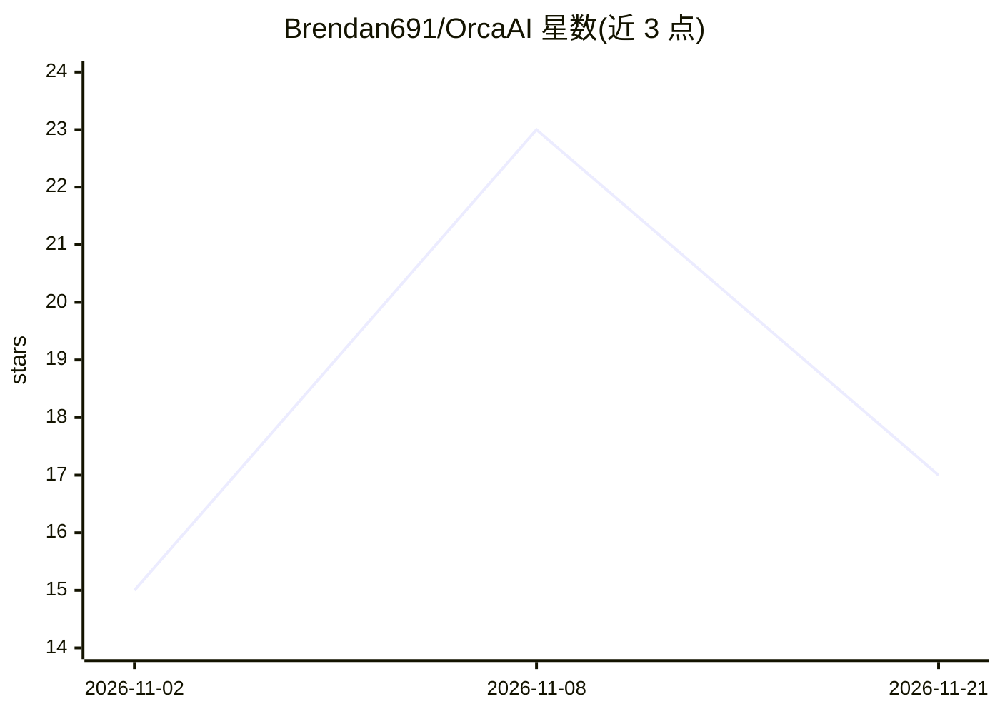

# Brendan691/OrcaAI

⭐ 17 · Python · MIT · 推送 2026-11-01 · [GitHub](https://github.com/Brendan691/OrcaAI) · 个人维护 · 中文 README

**海事知识管理可追溯 RAG 知识库，带定位引用与 AI 报告**

通用内核+领域包架构的知识库应用：浏览器插件/文件上传/粘贴文本采集入库，AI 按四维标签体系自动分类；检索链路为 AEF 自适应混合检索（向量/关键词/时间/标签动态加权、RRF 融合）加 CARE 交叉编码器精排，异常或无 Key 时自动降级。问答回答的角标绑定到文档/切片/字符范围/行号，可跳回原文，另支持基于知识库生成周报/预警类报告与团队协作。默认领域包为航运，换包可服务其他行业；单机 SQLite+Chroma 规模，多模态尚未支持，生产 Docker 部署路径当前未验证。

## 筛选速览

| 维度 | 判定 | 备注 |
|---|---|---|
| AI 角色 | `ai-native` | 本体是模型或模型工具 |
| 许可风险 | `permissive` | MIT |
| 部署形态 | `self-host` | docker 或自建部署 |
| 模型依赖 | — | README 未给出锁定关系 |
| 硬件要求 | — | 无带数字的原话,不猜 |
| 安装摩擦 | `low` | 无编译、无系统依赖或容器化 |
| 成熟度 | — | 结构信号不足 |

## 能力要点

- AEF 自适应混合检索：按查询动态分配向量/关键词/时间/标签权重并门控缺失信号
- CARE 交叉编码器精排，无 Key 或异常时自动回退 AEF
- 引用角标绑定切片/字符范围/行号，可跳回原文位置
- 通用内核+领域包设计，换包即换行业

## 适用场景

- 收藏行业文章报告并用自然语言提问，拿到可点回原文的回答
- 行业调研或论文写作时整理和检索专业知识
- 基于知识库生成周度市场简报等报告

## 场景标签

`知识库管理` `文档问答` · 领域:知识与检索

## 证据(README 行号)

> L3: **面向海事知识管理的可追溯 RAG 知识库**
> L42: - **通用内核**:采集、切片、向量化、知识库、AEF 混合检索、联网搜索、证据选择、CARE 重排、RAG 问答与报告生成 —— 不含任何"航运"字样。
> L118: |POST|`/api/chat`|知识库问答(RAG),返回带定位引用的答案|

## 星数曲线

2026-11-02 15 → 2026-11-21 17（+2）

---
*卡片 v1 · prompt 1.4 · 生成 2026-11-18 · 置信度 mid · 依据 README sha `40b63c1392ea` · [字段定义](../../DATASET.md)*
