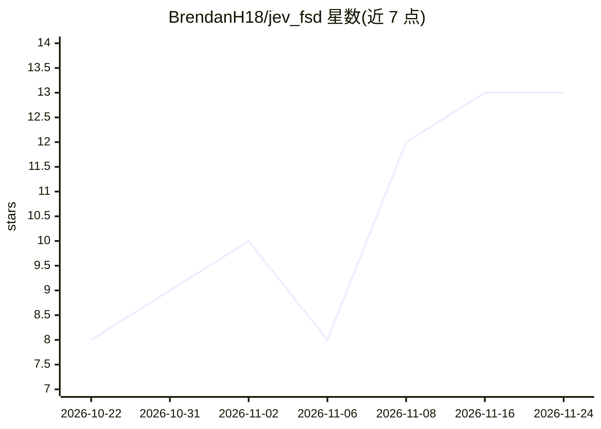

# BrendanH18/jev_fsd

⭐ 13 · JavaScript · MIT · 推送 2026-11-22 · [GitHub](https://github.com/BrendanH18/jev_fsd) · [官网](https://brendanh18.github.io/jev_fsd/) · 个人维护

**在真实加拿大街道上给 AI 模型做驾驶测试的模拟器**

基于 OpenStreetMap 数据构建 12 个加拿大社区街区的驾驶研究模拟器，提供 60 个手工设计挑战与 2 场路考。它把方向盘交给规则脚本、决策模型、聊天 LLM、自写 JavaScript agent 或人类玩家，所有 AI 驱动者共享传感器、候选动作、控制器与安全过滤，仅决策层不同；带回放、AI 视角叠加与竞技场对比（安全/舒适/延迟/成本）。声明为研究模拟器，不可用于控制真实车辆；人驾驶时不提供安全过滤与紧急制动。

## 筛选速览

| 维度 | 判定 | 备注 |
|---|---|---|
| AI 角色 | `ai-ecosystem` | LLM/agent 周边工具 |
| 许可风险 | `permissive` | MIT |
| 部署形态 | `None` |  |
| 模型依赖 | local-ok | 支持本地模型 |
| 硬件要求 | — | 无带数字的原话,不猜 |
| 安装摩擦 | `low` | 无编译、无系统依赖或容器化 |
| 成熟度 | — | 结构信号不足 |

## 能力要点

- 60 个真实街道挑战，覆盖学校 bus 法、黑冰、救护车让行等场景
- 所有驱动者共享同一传感器/控制器/安全检查，仅决策不同
- 驱动以录制形式提交，可无 key 回放
- 支持 OpenAI 兼容 API 的任意聊天模型与自写 JS agent

## 适用场景

- 对比不同 LLM 在同一驾驶挑战中的决策表现
- 自己开车体验并与 AI 驱动者对照评分
- 编写自定义 JavaScript 驾驶 agent 参加竞技场评测

## 场景标签

`模型评测` · 领域:评测与运维

## 证据(README 行号)

> L22: Jev Drive Lab puts those moments on real streets in twelve Canadian neighbourhoods, built from
> L23: OpenStreetMap, and gives the wheel to whoever you like: a hand-written rule set, a decision model, a
> L126: |**LLMs**|Any chat model behind an OpenAI-compatible API: OpenAI, OpenRouter, Groq, vLLM, LM Studio, Ollama…|A key

## 星数曲线

2026-10-22 8 → 2026-11-24 13（+5）

---
*卡片 v1 · prompt 1.4 · 生成 2026-11-18 · 置信度 high · 依据 README sha `0d794155e8b4` · [字段定义](../../DATASET.md)*
