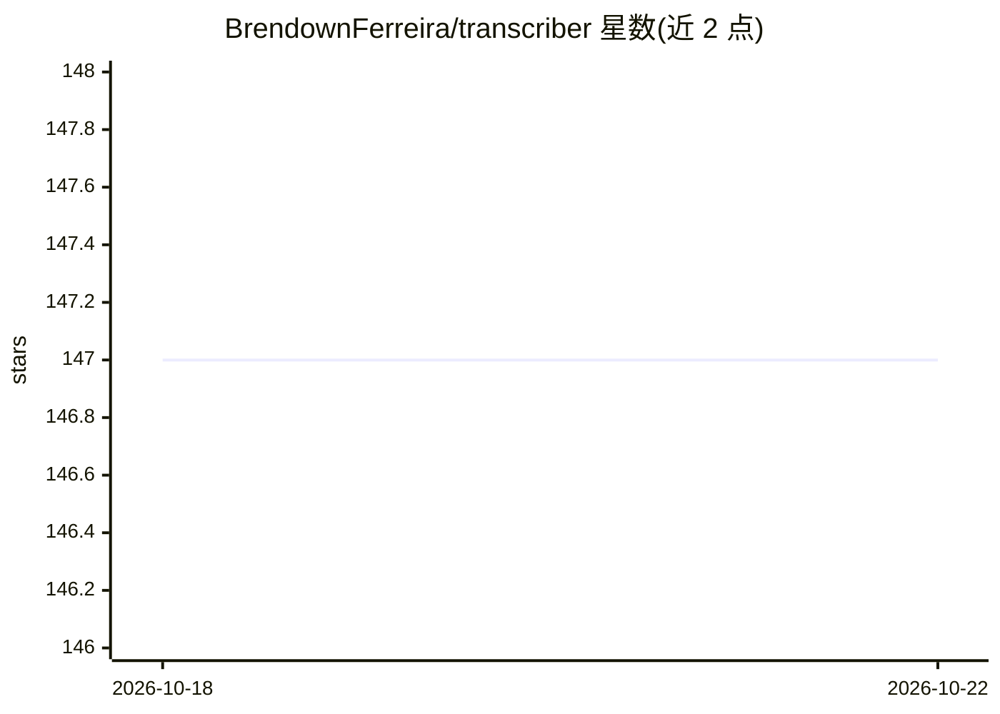

# BrendownFerreira/transcriber

⭐ 147 · Python · 推送 2026-03-18 · [GitHub](https://github.com/BrendownFerreira/transcriber) · [官网](https://noktech.com.br/softwares/transcriber) · 个人维护

**自托管 Whisper 语音转文字 Web 应用，本地转录音视频与 YouTube**

基于 FastAPI 与 OpenAI Whisper 的自托管 Web 应用：转写 YouTube 链接或上传的 mp3/mp4/wav 等文件，全程在本机运行，不依赖云服务。支持 openai-whisper（默认，需 FFmpeg）与 faster-whisper 双引擎自动切换，NVIDIA GPU 自动启用 CUDA 加速并带 CPU 回退；通过 WebSockets 提供实时进度，附带媒体库管理与转写历史，结果可下载为 .txt。需 Python 3.10-3.12（GPU 场景），FFmpeg 首次运行自动下载，提供 Docker 多阶段构建镜像。

## 筛选速览

| 维度 | 判定 | 备注 |
|---|---|---|
| AI 角色 | `ai-native` | 本体是模型或模型工具 |
| 许可风险 | `permissive` | — |
| 部署形态 | `self-host` | docker 或自建部署 |
| 模型依赖 | — | README 未给出锁定关系 |
| 硬件要求 | — | 无带数字的原话,不猜 |
| 安装摩擦 | `low` | 无编译、无系统依赖或容器化 |
| 成熟度 | — | 结构信号不足 |

## 能力要点

- openai-whisper 与 faster-whisper 双引擎，faster-whisper 作为快速回退
- 支持 YouTube URL 与本地上传（mp3/mp4/wav 等格式）转写
- NVIDIA GPU 自动 CUDA 加速，CPU 回退；WebSockets 实时进度
- FFmpeg 首次运行自动检测/安装，Docker 多阶段构建镜像

## 适用场景

- 在本机私有化转写音视频或 YouTube 内容，避免数据上云
- 实时查看转写进度并下载 .txt 文本
- 管理历史转写记录与音文配对文件库

## 场景标签

`语音识别` · 领域:感知与多模态

## 证据(README 行号)

> L9: **AI transcription without the cloud.**
> L10: An open-source, **privacy-first** web application powered by **OpenAI Whisper** and **FastAPI**. Transcribe YouTube
> L24: * 🤖 **Dual AI Engine:**

## 星数曲线

2026-10-18 147 → 2026-10-22 147（+0）

---
*卡片 v1 · prompt 1.4 · 生成 2026-10-22 · 置信度 mid · 依据 README sha `13c10aaca46c` · [字段定义](../../DATASET.md)*
