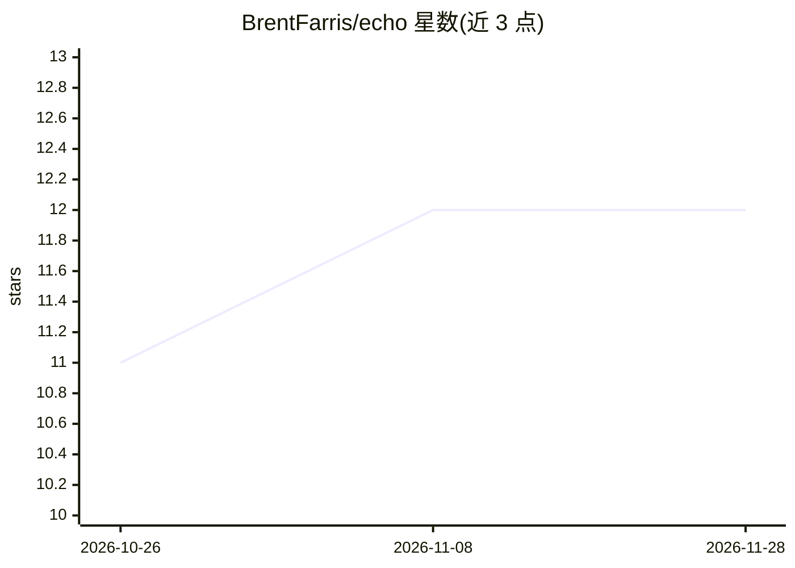

# BrentFarris/echo

⭐ 12 · Go · MIT · 推送 2026-11-06 · [GitHub](https://github.com/BrentFarris/echo) · 个人维护

**面向程序员的本地 AI/LLM 聊天工作台，带编辑器与外部 agent 接入**

Echo 是一个聊天优先的本地 LLM 工作台：核心包括命名 bot、模型流式输出、作用域文件操作与确定性 bot 协调，功能以插件形式安装。内置 Monaco 代码编辑器（文件浏览、书签、大纲、内联 AI 聊天）、Git/Fossil 提交历史浏览、斜杠命令系统、删除聊天 30 天保留恢复，以及把 Codex/Claude Code CLI 作为外部 agent 连接的机制。Windows 提供 echo.exe 运行方式，启动桌面应用或回退到 localhost 浏览器访问，支持无头模式与独立数据目录参数。

## 筛选速览

| 维度 | 判定 | 备注 |
|---|---|---|
| AI 角色 | `ai-ecosystem` | LLM/agent 周边工具 |
| 许可风险 | `permissive` | MIT |
| 部署形态 | `desktop` | 安装包/桌面程序 |
| 模型依赖 | — | README 未给出锁定关系 |
| 硬件要求 | — | 无带数字的原话,不猜 |
| 安装摩擦 | `medium` | 含编译或系统依赖之一 |
| 成熟度 | — | 结构信号不足 |

## 能力要点

- 聊天优先工作台：bot、模型流式输出、作用域文件操作、确定性 bot 协调，功能以插件安装
- Monaco 内置编辑器，Ctrl+I 内联 AI 聊天，红绿预览与可撤销的变更接受
- 外部 agent 集成：接入本机安装的 Codex / Claude Code CLI，按订阅登录鉴权，原生会话跨重启保持
- 删除聊天保留 30 天可恢复，斜杠命令支持自定义文本/插件/应用命令

## 适用场景

- 在本机以多 bot 形式使用多种模型连接进行编码对话
- 在编辑器中对光标处代码发起内联 AI 修改建议
- 把已订阅的 Codex / Claude Code CLI 作为外部 agent 接入统一界面
- 浏览 Git/Fossil 仓库的提交历史与只读差异

## 场景标签

`编码 Agent` `AI 助手` · 领域:编码与开发

## 证据(README 行号)

> L3: The chat-first Echo application now lives at the repository root. Echo, named bots, model streaming, scoped file ope
> L21: Install the vendor's native CLI on the machine running Echo and sign in under the same operating-system account: `c
> L51: Run `echo.exe`. Echo opens the installed desktop app when available, falling back to **http://localhost:3740** in y

## 星数曲线

2026-10-26 11 → 2026-11-28 12（+1）

---
*卡片 v1 · prompt 1.4 · 生成 2026-11-18 · 置信度 mid · 依据 README sha `782237a2a855` · [字段定义](../../DATASET.md)*
